# HANAMORPH BW Migration & Modernization Studio
# Canonical Metadata Model & Entity-Relationship Schema — Architecture Blueprint 1.0

**Document Reference:** `BW-MIG-MODEL-1.0`  
**Status:** Approved for Architecture Design  
**Target Studio:** `BW_Migration_Studio/bw-studio`  
**Classification:** SAP Enterprise Modernization Architecture  

---

## 1. Design Principles of the Canonical Metadata Model

The **Canonical Metadata Model** serves as the technology-neutral Intermediate Representation (IR) within HANAMORPH. It decouples disparate SAP source versions (BW 7.4, 7.5, BW/4HANA, AnyDB, HANA) from heterogeneous cloud target artifacts (SAP Datasphere CSN 2.0, HANA Cloud DDL, Replication Flow JSON, BW Bridge abapGit XML, and BDC Data Products).

### Core Principles:
1. **Deterministic Uniform Resource Names (URNs):** Every entity is uniquely identified across systems and snapshots via a standard URN syntax:  
   `urn:sap:bw:<system_id>:<object_type>:<technical_name>`  
   *(e.g., `urn:sap:bw:s21:adso:zsam_so01` or `urn:sap:bw:s21:trfn:00O2T4A9D382`)*.
2. **First-Class Semantic Preservation:** Measures, dimensions, compounding parent relationships, currency/unit linkages (`0CURRENCY`, `0UNIT`), and aggregation behaviors are preserved as explicit attributes rather than lost in flat column definitions.
3. **Immutable Provenance:** Every canonical entity and field records its extraction source, extractor adapter, system release version, and extraction timestamp.

---

## 2. Entity-Relationship Model (Canonical ERD)

### Diagram 6: Canonical Metadata Model ERD

```mermaid
erDiagram
    SYSTEM_CONNECTION ||--o{ INFO_AREA : organizes
    INFO_AREA ||--o{ CANONICAL_OBJECT : contains
    
    CANONICAL_OBJECT ||--o{ OBJECT_FIELD : defines
    OBJECT_FIELD ||--o{ FIELD_SEMANTICS : annotated_by
    OBJECT_FIELD ||--o{ FIELD_MAPPING_RULE : mapped_in
    
    CANONICAL_OBJECT ||--o{ DEPENDENCY_EDGE : source_of
    CANONICAL_OBJECT ||--o{ DEPENDENCY_EDGE : target_of
    
    CANONICAL_OBJECT ||--o| ADSO_DETAIL : specialized_as
    CANONICAL_OBJECT ||--o| COMPOSITE_PROVIDER_DETAIL : specialized_as
    CANONICAL_OBJECT ||--o| TRANSFORMATION_DETAIL : specialized_as
    CANONICAL_OBJECT ||--o| DTP_DETAIL : specialized_as
    CANONICAL_OBJECT ||--o| QUERY_DETAIL : specialized_as
    
    TRANSFORMATION_DETAIL ||--o{ TRANSFORMATION_ROUTINE : executes
    
    CANONICAL_OBJECT ||--o{ ASSESSMENT_EVIDENCE : evaluated_by
    CANONICAL_OBJECT ||--o| MIGRATION_PLAN_ITEM : allocated_to
    MIGRATION_PLAN_ITEM ||--o{ TARGET_ARTIFACT : generates
    TARGET_ARTIFACT ||--o{ VALIDATION_RESULT : verified_by

    SYSTEM_CONNECTION {
        string system_id PK "e.g. S21"
        string host
        string client
        string release_version "e.g. 750 SP23"
        string db_type "HANA / AnyDB"
        boolean is_read_only "Strict True"
    }

    INFO_AREA {
        string infoarea_id PK
        string technical_name
        string description
        string parent_infoarea_id FK
    }

    CANONICAL_OBJECT {
        string urn PK "urn:sap:bw:sys:type:name"
        string system_id FK
        string object_type "ADSO, HCPR, IOBJ, TRFN, DTPA, ELEM"
        string technical_name
        string description
        string infoarea_id FK
        string active_status "A, M, D"
        timestamp extracted_at
        string content_hash "MD5 signature"
    }

    OBJECT_FIELD {
        string field_urn PK "urn:...:field:name"
        string object_urn FK
        string field_name
        int position
        string data_type "CHAR, NUMC, DATS, DEC, CURR, UNIT"
        int length
        int decimals
        boolean is_primary_key
        boolean is_nullable
        string infoobject_ref "e.g. 0CUSTOMER"
    }

    FIELD_SEMANTICS {
        string semantic_id PK
        string field_urn FK
        string semantic_type "DIMENSION, MEASURE, ATTRIBUTE, TIME"
        string aggregation_role "SUM, MIN, MAX, NONE"
        string currency_unit_field_urn FK "Link to 0CURRENCY or 0UNIT"
        string compounding_parent_urn FK "Compounding hierarchy key"
    }

    ADSO_DETAIL {
        string object_urn PK, FK
        string adso_type "STANDARD, STAGING, DIRECT_WRITE"
        boolean has_change_log
        boolean has_active_table
        boolean has_inbound_queue
    }

    COMPOSITE_PROVIDER_DETAIL {
        string object_urn PK, FK
        string join_type "INNER, LEFT_OUTER, UNION"
        json join_tree_definition "Complete node join graph"
        json projection_fields
    }

    TRANSFORMATION_DETAIL {
        string object_urn PK, FK
        string source_object_urn FK
        string target_object_urn FK
        int rule_count
        boolean has_expert_routine
        boolean has_start_routine
        boolean has_end_routine
    }

    TRANSFORMATION_ROUTINE {
        string routine_id PK
        string transformation_urn FK
        string routine_type "START, END, EXPERT, FIELD"
        string abap_code "Raw extracted ABAP logic"
        int line_count
        string complexity_tier "LOW, MEDIUM, HIGH, BLOCKED"
    }

    DTP_DETAIL {
        string object_urn PK, FK
        string source_urn FK
        string target_urn FK
        string extraction_mode "FULL, DELTA"
        boolean cdc_capable
        int package_size
    }

    QUERY_DETAIL {
        string object_urn PK, FK
        string infoprovider_urn FK
        json restricted_key_figures
        json calculated_key_figures
        json variables_definition
    }

    DEPENDENCY_EDGE {
        string edge_id PK
        string source_urn FK
        string target_urn FK
        string dependency_type "DATA_FLOW, MODEL_INCLUSION, FIELD_DERIVATION"
        int topological_level
    }

    MIGRATION_PLAN_ITEM {
        string plan_item_id PK
        string object_urn FK
        string target_strategy "NATIVE_DATASPHERE, BW_BRIDGE, BDC, HYBRID"
        int wave_number
        string approval_status "PENDING, APPROVED, REJECTED"
    }

    TARGET_ARTIFACT {
        string artifact_id PK
        string plan_item_id FK
        string artifact_type "CSN_TABLE, CSN_VIEW, HANA_SQL_DDL, FLOW_JSON, ABAPGIT_XML"
        string file_path
        string checksum_sha256
        timestamp generated_at
    }

    VALIDATION_RESULT {
        string validation_id PK
        string artifact_id FK
        int validation_level "1 to 7"
        string rule_name
        string status "PASSED, WARNING, FAILED"
        string message
        json evidence_details
    }
```

---

## 3. Detailed Entity Dictionary & Semantic Mappings

### 3.1 Field Semantics & Currency/Unit Integrity
A critical defect in naive BW-to-cloud conversions is treating currency and unit amounts as raw decimal numbers without binding their unit attributes:
- **`FIELD_SEMANTICS.currency_unit_field_urn`**: Directly links a monetary measure (e.g., `NET_AMOUNT` of type `CURR`) to its qualifying currency code (e.g., `CURRENCY_CODE` referencing `0CURRENCY`).
- **`FIELD_SEMANTICS.compounding_parent_urn`**: Captures compound keys (e.g., Cost Center `0COSTCENTER` is compounded to Controlling Area `0CO_AREA`). In target CSN generation, this produces compound primary keys to prevent cardinality inflation.

### 3.2 Dynamic Type Mapping Matrix
The model transforms SAP ABAP Data Dictionary types into ISO/CSN canonical primitives:

| ABAP DDIC Type | Canonical Data Type | Datasphere CSN Type | HANA Cloud SQL Type |
| :--- | :--- | :--- | :--- |
| `CHAR` / `SSTRING` | `String` | `cds.String(length)` | `NVARCHAR(length)` |
| `NUMC` | `String (Numeric)` | `cds.String(length)` | `NVARCHAR(length)` |
| `DATS` | `Date` | `cds.Date` | `DATE` |
| `TIMS` | `Time` | `cds.Time` | `TIME` |
| `DEC` / `FLTP` | `Decimal` | `cds.Decimal(p, s)` | `DECIMAL(p, s)` |
| `CURR` | `CurrencyAmount` | `cds.Decimal(p, s)` + `@Semantics.amount.currencyCode` | `DECIMAL(p, s)` |
| `CUKY` | `CurrencyCode` | `cds.String(5)` + `@Semantics.currencyCode: true` | `NVARCHAR(5)` |
| `UNIT` | `UnitOfMeasure` | `cds.String(3)` + `@Semantics.unitOfMeasure: true` | `NVARCHAR(3)` |
| `QUAN` | `Quantity` | `cds.Decimal(p, s)` + `@Semantics.quantity.unitOfMeasure` | `DECIMAL(p, s)` |
