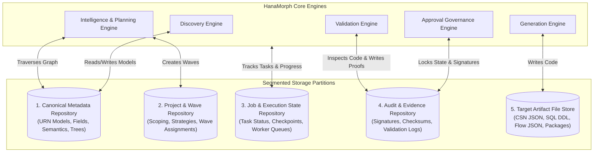
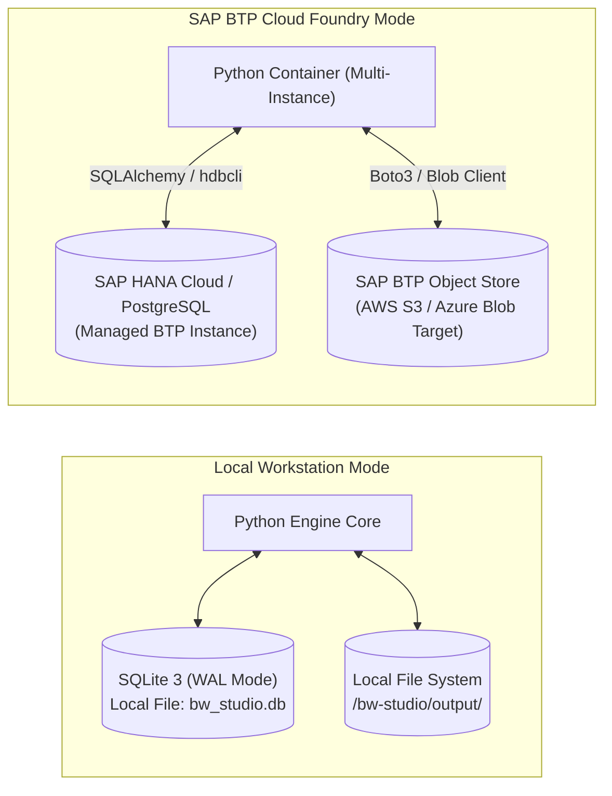

# HANAMORPH BW Migration & Modernization Studio
# Database & Persistence Architecture — Architecture Blueprint 1.0

**Document Reference:** `BW-MIG-DB-1.0`  
**Status:** Approved for Architecture Design  
**Target Studio:** `BW_Migration_Studio/bw-studio`  
**Classification:** SAP Enterprise Modernization Architecture  

---

## 1. Logical Repository Separation

To achieve isolation, auditability, and horizontal scalability, HANAMORPH segments its persistence layer into five distinct logical repositories:



### 1.1 Partition Definitions
1. **Canonical Metadata Repository:** Contains normalized URN-indexed definitions of all discovered BW objects, attributes, formulas, join graphs, and routines. Append-only during discovery; versioned by extraction snapshot.
2. **Project & Wave Repository:** Stores user project configurations, wave definitions, manual strategy overrides, and target space assignments.
3. **Job & Execution State Repository:** Ephemeral state store managing background discovery jobs, pagination offsets, active worker threads, and failure retry queues.
4. **Audit & Evidence Repository:** Cryptographically verifiable, immutable event log capturing every approval action, sign-off identity, timestamp, and validation evidence proof.
5. **Target Artifact File Store:** Hierarchical file storage holding generated code files (`.csn`, `.sql`, `.flow.json`, `.xml`, `.zip`) indexed by project wave and timestamp.

---

## 2. Evaluation of Current SQLite Implementation

### 2.1 Current Implementation Overview
The current studio backend (`db.py`) utilizes a single SQLite file: `bw_studio.db` located within the local application folder. Tables currently implemented include:
- `systems`
- `bw_objects`
- `assessments`
- `waves`
- `generation_jobs`
- `approvals`

### 2.2 Strengths for Local Desktop Engineering
- **Zero Configuration:** Embeds directly into the Python standard library with zero external daemon or database server dependencies.
- **Atomic Reliability:** Full ACID compliance ensures data integrity during sudden application termination or laptop sleep states.
- **Portability:** The entire project state and metadata catalog can be copied or archived as a single file.

### 2.3 Limitations & Bottlenecks for Enterprise Scale
- **Concurrency Locks:** Default `DELETE` journal mode locks the entire database file during write transactions, causing `database is locked` errors when multiple discovery worker threads write concurrently.
- **No Native JSON Querying:** Querying nested join trees or TRCS rule structures requires Python application-level deserialization.
- **Single Host Constraint:** Cannot be scaled horizontally across multiple BTP Cloud Foundry container instances.

### 2.4 Immediate Architecture Optimization for Local SQLite
Before migrating to BTP, the local SQLite database must be configured with:
```sql
PRAGMA journal_mode = WAL;         -- Enables concurrent multi-reader, single-writer throughput
PRAGMA synchronous = NORMAL;       -- Balances durability with write latency
PRAGMA foreign_keys = ON;          -- Enforces relational referential integrity
PRAGMA busy_timeout = 10000;       -- Prevents immediate database locked errors under load
```

---

## 3. Enterprise BTP Cloud Persistence Strategy

When deployed to SAP BTP Cloud Foundry, HANAMORPH transitions seamlessly from SQLite to an enterprise cloud database without modifying application domain models:



### 3.1 Target Enterprise Database Options on SAP BTP
1. **SAP HANA Cloud (Recommended Enterprise Path):**
   - High-speed columnar in-memory store.
   - Native Graph Engine (`GRAPH_TABLE`) for instantaneous traversal of deep BW dependency DAGs across 100,000+ objects.
   - Native JSON DocStore for flexible storage of unstructured join conditions and TRCS rule definitions.
2. **PostgreSQL on SAP BTP (Alternative Open-Source Path):**
   - Excellent JSONB indexing and relational robustness.
   - Managed service available natively across AWS, Azure, and GCP BTP regions.

---

## 4. Migration & Schema Versioning Framework
- HANAMORPH adopts **Alembic** as the canonical database migration tool.
- Database schemas are versioned strictly through forward/backward migration scripts in `db/migrations/`.
- The storage abstraction layer utilizes **SQLAlchemy 2.0 Core/ORM**, guaranteeing dialect portability between SQLite (local development) and HANA Cloud / PostgreSQL (cloud production).
