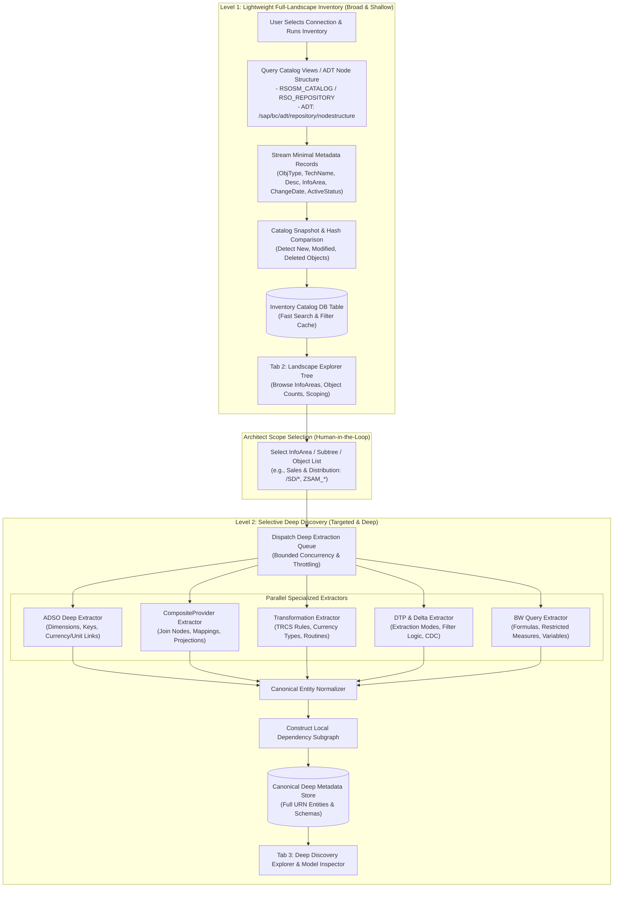

# HANAMORPH BW Migration & Modernization Studio
# Discovery Architecture: Two-Level Discovery Pipeline — Architecture Blueprint 1.0

**Document Reference:** `BW-MIG-DISC-1.0`  
**Status:** Approved for Architecture Design  
**Target Studio:** `BW_Migration_Studio/bw-studio`  
**Classification:** SAP Enterprise Modernization Architecture  

---

## 1. Overview of the Two-Level Discovery Methodology

Attempting a deep, recursive scan of an entire enterprise SAP BW landscape (often comprising 50,000+ InfoObjects, 5,000+ ADSOs, 10,000+ Transformations, and 20,000+ BW Queries) will saturate network connections, trigger SAP Dialog process timeouts, and cause severe memory exhaustion.

HANAMORPH solves this by decoupling discovery into two distinct, sequential phases:
1. **Level 1: Lightweight Full-Landscape Inventory** (Fast, shallow catalog sweep across the entire repository).
2. **Level 2: Selective Deep Discovery** (Targeted, exhaustive syntactic and semantic parsing of user-selected scopes).

### Diagram 5: Two-Level Discovery Pipeline

---

## 2. Level 1: Lightweight Full-Landscape Inventory

### 2.1 Technical Approach
- **Query Strategy:** Executes minimal non-locking SQL or shallow ADT node traversal against SAP repository catalog tables.
- **Data Target:** Only 6 scalar fields per object:
  - `OBJECT_TYPE` (e.g., `ADSO`, `HCPR`, `IOBJ`, `TRFN`, `DTPA`, `ELEM`)
  - `TECHNICAL_NAME` (e.g., `ZSAM_SO01`)
  - `DESCRIPTION` (e.g., `Sales Order Header and Items`)
  - `INFOAREA` (e.g., `SD_ANALYTICS`)
  - `LAST_CHANGED_AT` (Timestamp / ISO string)
  - `ACTIVE_STATUS` (`A` for Active, `M` for Modified, `D` for Deleted)
- **Throughput:** A landscape of 50,000 objects is fully enumerated in under 12 seconds with payload size $< 4 \text{ MB}$.

### 2.2 Change Detection & Snapshot History
Every Level 1 inventory run generates a unique `snapshot_id`. The engine calculates an MD5 fingerprint of `(TECHNICAL_NAME + LAST_CHANGED_AT + ACTIVE_STATUS)`:
- If hash matches previous snapshot: Object marked `UNCHANGED`.
- If hash differs: Object marked `MODIFIED`.
- If missing in current sweep: Object marked `DECOMMISSIONED`.
- If new: Object marked `NEW`.

---

## 3. Level 2: Selective Deep Discovery

### 3.1 Object-Specific Deep Extractors

| Object Type | Deep Metadata Captured | Extraction Endpoint / Structure |
| :--- | :--- | :--- |
| **ADSO** | Primary keys, dimensions, fields, data types, lengths, decimal places, referential InfoObjects, Currency/Unit linkages (`0CURRENCY`, `0UNIT`), Change Log activation state. | ADT `/sap/bc/adt/bw/modeling/adso/*` or DDIC `RSOADSO` / `RSDODSO` / `RSADSOFIELD`. |
| **CompositeProvider (HCPR)** | Entity join graph, join conditions (Inner/Left Outer), union nodes, field mappings, constant assignments, temporal joins, output characteristics. | ADT `/sap/bc/adt/bw/modeling/compositeprovider/*` or XML definition `RSOCP`. |
| **Transformation (TRFN)** | Source/target entity links, field-to-field mapping rules, rule types (`DIRECT`, `ROUTINE`, `FORMULA`, `READ_MASTER_DATA`), start/end/expert routines, currency conversion types. | Table `RSTRAN` / `RSTRANRULE` / `RSTRANFIELD` or ADT Transformation XML. |
| **Data Transfer Process (DTP)** | Source, target, extraction mode (`FULL`, `DELTA`), error stack settings, filter criteria, semantic group keys, package size. | Table `RSBKDTP` or Function Module `RS_DTP_GET_DETAIL`. |
| **BW Query (ELEM)** | Query structure, free characteristics, rows, columns, calculated key figures, restricted key figures, variables, exceptions, conditions. | Table `RSZELTDIR` / `RSZCOMPDIR` or ADT Query XML service. |

### 3.2 Handling Missing Metadata & Broken Dependencies
- In enterprise BW landscapes, transformations often reference decommissioned InfoSources or archived DataSources.
- When an object reference cannot be resolved during Deep Discovery, the engine inserts a **`VirtualStubEntity`** in the canonical model:
  - Flagged as `STATUS: UNRESOLVED_DEPENDENCY`.
  - Assigned a confidence penalty ($C_{dep} = 0.40$).
  - Prevents fatal crashes and alerts the migration architect during Assessment (Tab 4).

---

## 4. Source-System Load Protection & Throttling

To guarantee zero operational disturbance to production SAP BW application servers, the Discovery Engine enforces strict concurrency and throttling controls:
1. **Bounded Thread Concurrency:** Deep extraction workers are restricted to a maximum of 4 concurrent worker threads.
2. **Packet Throttling (Jittered Sleep):** An artificial delay of 50ms–150ms is enforced between successive ADT/RFC calls to avoid Dialog work process monopolization.
3. **Session Re-Use:** Uses persistent HTTP keep-alive connections to eliminate TCP handshake overhead and authentication storms.
4. **Memory Guard:** Parsed XML structures are streamed and transformed into canonical JSON rows before persisting to disk; raw XML payloads are immediately unreferenced for garbage collection.
