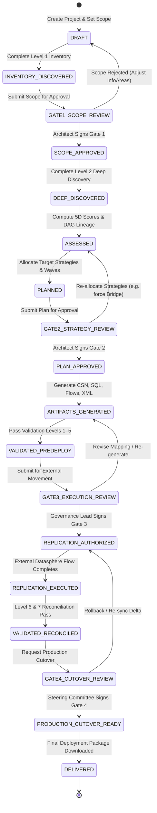

# HANAMORPH BW Migration & Modernization Studio
# Execution & Human-in-the-Loop (HITL) Approval Architecture — Architecture Blueprint 1.0

**Document Reference:** `BW-MIG-APPR-1.0`  
**Status:** Approved for Architecture Design  
**Target Studio:** `BW_Migration_Studio/bw-studio`  
**Classification:** SAP Enterprise Modernization Architecture  

---

## 1. Principles of Human-in-the-Loop (HITL) Governance

Enterprise SAP migrations cannot be executed as unmonitored "black-box" automations. Flawed transformations, unintended schema collisions, or unapproved data replication can disrupt enterprise financial and reporting integrity.

HANAMORPH enforces a **Formal State Machine with Mandatory Human-in-the-Loop (HITL) Gates**. Automation proceeds only up to an approval boundary, pauses, generates an immutable audit checkpoint with technical evidence, and waits for a designated human architect or lead developer to grant explicit digital sign-off.

---

## 2. The 8-Gate Approval State Machine

### Diagram 14: Approval State Machine

---

## 3. The 8 Formal Approval Checkpoints

| Gate # | Checkpoint Name | Approver Role | Required Evidence Package |
| :---: | :--- | :--- | :--- |
| **Gate 1** | **Discovery Scope Gate** | Migration Architect | Inventory catalog snapshot, object counts by InfoArea, exclusions list. |
| **Gate 2** | **Target Strategy Allocation Gate** | Enterprise Architect | 5D feasibility report, confidence breakdown, risk tier justifications. |
| **Gate 3** | **Routine Redesign Sign-Off Gate** | BW Lead Developer | SQL View redesign specs for complex ABAP Start/End routines. |
| **Gate 4** | **Wave Schedule Gate** | Project Delivery Lead | Dependency wave DAG, topological sequencing, effort estimations. |
| **Gate 5** | **Artifact Generation Gate** | Datasphere Modeler | Generated CSN 2.0 schemas, HANA SQL DDL, syntax validation reports. |
| **Gate 6** | **External Replication Gate** | Data Governance Lead | Replication Flow JSON, source CDC impact assessment, least-privilege review. |
| **Gate 7** | **Reconciliation & Parity Gate** | QA & Test Lead | Record count comparison, currency/unit hash parity, measure variance $< 0.001\%$. |
| **Gate 8** | **Production Cutover Gate** | Steering Committee | Full delivery audit trail, rollback runbook, signed off by all stakeholders. |

---

## 4. Immutable Audit Trail & Cryptographic Signatures

### 4.1 Schema of the Audit Record
Every state transition produces an append-only row in `audit_approvals`:
- `approval_id`: UUIDv4
- `project_id`: Project identifier
- `gate_number`: 1 to 8
- `status`: `APPROVED`, `REJECTED`, or `CONDITIONAL_PASS`
- `approver_id`: User corporate email or SAP BTP user ID
- `approved_at`: ISO 8601 UTC timestamp
- `comment`: Mandatory rationale entered by approver
- `evidence_payload_hash`: SHA-256 fingerprint of the entire underlying model, assessment, and validation evidence.

### 4.2 Tamper-Evident Hashing
To prevent unauthorized post-hoc database alterations, each audit entry computes an HMAC signature:
$$\text{Signature} = \text{HMAC-SHA256}(\text{approval\_id} + \text{gate\_number} + \text{status} + \text{approved\_at} + \text{evidence\_payload\_hash}, K_{system})$$
If any row in the SQLite or cloud repository is modified directly via an external SQL client, the signature validation check fails immediately, locking down the delivery packager.

---

## 5. Rollback & Recovery Procedures

If an external replication job fails or post-deployment validation detects data divergence:
1. **Automated Quench:** HANAMORPH triggers an alert and halts downstream wave deployment.
2. **State Reversion:** The project state transitions back to `VALIDATED_PREDEPLOY` or `PLAN_APPROVED`.
3. **Execution Runbook:** The packager generates a deterministic `rollback_datasphere.sh` script that drops created CSN entities and deletes replication flows cleanly.
