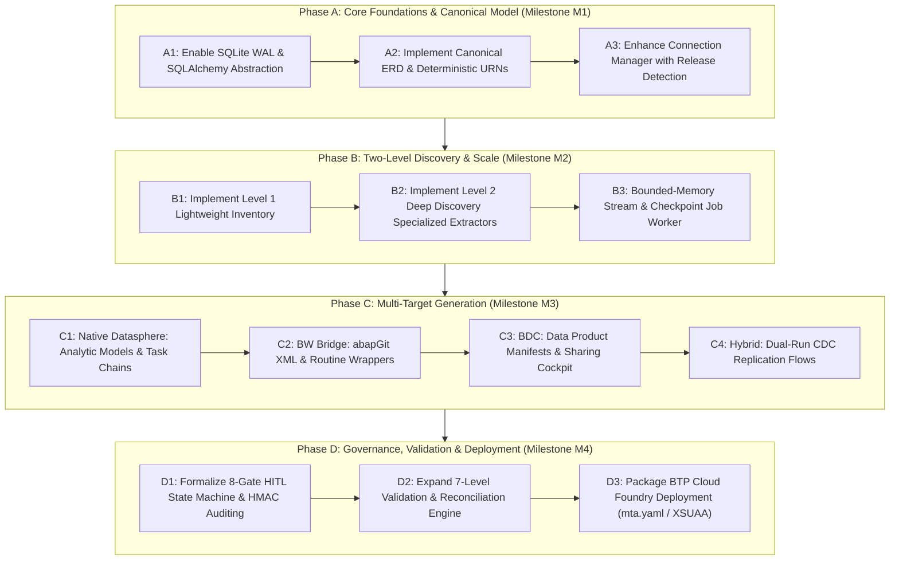

# HANAMORPH BW Migration & Modernization Studio
# Master Implementation Roadmap: Phases A through D — Architecture Blueprint 1.0

**Document Reference:** `BW-MIG-ROAD-1.0`  
**Status:** Approved for Architecture Design  
**Target Studio:** `BW_Migration_Studio/bw-studio`  
**Classification:** SAP Enterprise Modernization Architecture  

---

## 1. Engineering Roadmap Overview & Guiding Principles

The modernization of the HANAMORPH BW Migration Studio is structured into four sequential, dependency-aware engineering phases:
- **Phase A: Core Foundations, Schema Governance & Enhanced Canonical Data Model**
- **Phase B: Two-Level Discovery, Bounded Ingestion & Large-Scale Processing**
- **Phase C: Multi-Target Generation Engines (Datasphere, Bridge, BDC, Hybrid)**
- **Phase D: HITL Approval Governance, Multi-Tier Validation & BTP Enterprise Deployment**

### Non-Negotiable Implementation Invariants:
1. **Design-First Verification:** No code is modified until the architectural specifications and ADRs are formally accepted.
2. **Zero Test Regressions:** The 43 passing tests in `tests/run_all_tests.py` must remain 100% green across all commits.
3. **Strict S21 Read-Only Isolation:** No code changes may introduce mutating HTTP verbs (`POST`/`PUT`/`DELETE`) to SAP endpoints or execute CTS transport requests.
4. **Preservation of Existing Studios:** The four adjacent HANAMORPH studios remain completely untouched.

---

## 2. Dependency-Aware Phased Engineering Schedule

---

## 3. Detailed Phase Breakdown & Acceptance Criteria

### Phase A: Core Foundations & Canonical Data Model
- **Work Package A.1 (Persistence Hardening):**
  - Configure `PRAGMA journal_mode = WAL;` and foreign key enforcement in `db.py`.
  - Abstract SQLite operations behind repository interfaces to support future BTP HANA Cloud / PostgreSQL targets.
- **Work Package A.2 (Canonical Metadata Model):**
  - Implement deterministic URN resolution (`urn:sap:bw:<system>:<type>:<name>`).
  - Introduce tables/classes for `FieldSemantics` (explicit currency/unit linkages and compounding keys).
- **Work Package A.3 (Connectivity & Capability Detection):**
  - Add automatic SAP release and component probing (`SAP_BW 750`, `DW4CORE 200`, `HANA 2.0`) to `BWConnectionManager`.
  - Enforce least-privilege verification and verify the strict read-only HTTP verb jail.
- **Deliverables:** Updated `db.py`, `models.py`, `connection_manager.py`, and test suite `test_phase_a.py`.
- **Acceptance Criteria:** Zero regression on existing 43 tests; URN resolution passes 100% of test fixtures; WAL mode confirmed active.

---

### Phase B: Two-Level Discovery & Large-Scale Processing
- **Work Package B.1 (Level 1 Lightweight Inventory):**
  - Build `InventoryScanner` to rapidly catalog objects from ADT node structures or DDIC tables without deep parsing.
  - Implement snapshot hashing (MD5) to detect new, modified, and decommissioned BW objects.
- **Work Package B.2 (Level 2 Deep Discovery):**
  - Refactor `discovery.py` into specialized extractors: ADSO, CompositeProvider, Transformation (TRCS), DTP, and Query.
  - Build `VirtualStubEntity` handler for missing upstream dependencies.
- **Work Package B.3 (Asynchronous Bounded Processing):**
  - Implement background worker queue with chunked batching (1,000 items) and streaming SAX XML parsers.
  - Implement persistent job checkpoints enabling resume upon failure.
- **Deliverables:** `inventory.py`, refactored `discovery.py`, background worker module, and UI binding to Tab 2 & 3.
- **Acceptance Criteria:** Full inventory of S21 benchmark catalog in $< 15\text{s}$; deep extraction of `ZSAM_SO01` and `ZSAM_SO_CP` completed with bounded RSS memory $< 512\text{ MB}$.

---

### Phase C: Multi-Target Generation Engines
- **Work Package C.1 (Native Datasphere Enhancements):**
  - Add Analytic Model generation (`@Analytics.dataCategory: "CUBE"`) for BW BEx Queries.
  - Emit complete `.flow.json` Replication Flow specifications with Change Log CDC bindings.
- **Work Package C.2 (SAP BW Bridge Engine):**
  - Implement `BWBridgeGenerator` (`bridge.py`) producing abapGit XML archives (`.adso.xml`, `.iobj.xml`) and BTP ABAP Cloud-compliant routine wrappers.
- **Work Package C.3 (SAP BDC Data Product Engine):**
  - Implement `BDCGenerator` (`bdc.py`) producing `data-product.json` manifests, BW Data Subscription descriptors, and Data Sharing Cockpit contracts.
- **Work Package C.4 (Hybrid Modernization Coordinator):**
  - Implement `HybridCoordinator` (`hybrid.py`) generating dual-run replication flows, delta sync scripts, and cutover checklists.
- **Deliverables:** `datasphere.py` (enhanced), `bridge.py`, `bdc.py`, `hybrid.py`, and target generation test suites.
- **Acceptance Criteria:** Bit-for-bit valid CSN 2.0 schemas verified against SAP specs; abapGit XML passes schema validation; BDC manifests match SAP official documentation.

---

### Phase D: HITL Governance, Multi-Tier Validation & BTP Deployment
- **Work Package D.1 (8-Gate Approval Governance):**
  - Implement formal state machine transitions in `approval.py`.
  - Implement HMAC-SHA256 digital signature hashing for all approval checkpoints in `audit_approvals`.
- **Work Package D.2 (7-Level Validation Framework):**
  - Expand `validation.py` into a 7-tier pipeline: syntax, datatype, semantics, graph closure, CDC equivalence, dry-run, and external reconciliation evidence.
- **Work Package D.3 (BTP Enterprise Packaging):**
  - Create deployment manifests (`mta.yaml`, `manifest.yml`, `xs-security.json`) for SAP BTP Cloud Foundry.
  - Configure SAP Destination Service and Cloud Connector routing.
- **Deliverables:** `approval.py`, `validation.py` (enhanced), deployment descriptors, and end-to-end integration test runner.
- **Acceptance Criteria:** State machine blocks unauthorized generation; Level 1–5 validations pass with zero false positives; MTA build packages successfully.

---

## 4. Risk Matrix & Mitigation Strategies

| Risk Description | Severity | Likelihood | Mitigation Strategy |
| :--- | :---: | :---: | :--- |
| **Accidental Mutation on SAP S21** | **CRITICAL** | Very Low | Hardcoded HTTP verb whitelist (GET/HEAD only); blocked write FMs; least-privilege `Z_BW_MIGRATION_READ` enforcement. |
| **Out-Of-Memory (OOM) on Large BW Scans** | **HIGH** | Medium | Strict bounded memory streaming; SAX pull parsing; batch flush every 1,000 entities; garbage collection enforcement. |
| **Complex ABAP Routines Failing Conversion** | **HIGH** | High | 5D assessment detects complex routines; routes objects to BW Bridge or generates human-in-the-loop redesign alerts. |
| **Data Inconsistency in Dual-Run Hybrid** | **MEDIUM** | Medium | Level 7 reconciliation framework validates source/target record counts and measure sums before cutover sign-off. |
| **BTP Service Dependency Unavailability** | **LOW** | Medium | Seamless fallback to local standalone mode (SQLite + local filesystem) with zero external cloud dependencies. |
