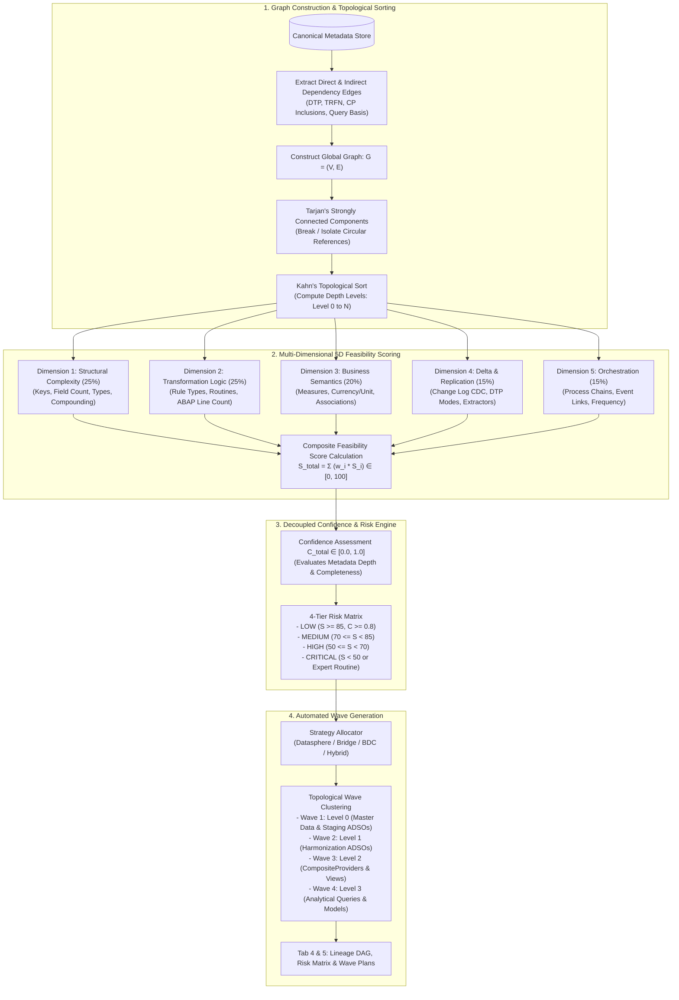

# HANAMORPH BW Migration & Modernization Studio
# Intelligence, Lineage & Assessment Engine Architecture — Architecture Blueprint 1.0

**Document Reference:** `BW-MIG-INTEL-1.0`  
**Status:** Approved for Architecture Design  
**Target Studio:** `BW_Migration_Studio/bw-studio`  
**Classification:** SAP Enterprise Modernization Architecture  

---

## 1. Overview of the Intelligence Architecture

The **Intelligence Engine** (`assessment.py`) transforms raw discovered metadata into an actionable modernization roadmap. It constructs a global Directed Acyclic Graph (DAG) of the entire BW landscape, evaluates technical migration feasibility across five orthogonal dimensions, computes decoupled confidence scores, and automatically organizes objects into dependency-ordered migration waves.

---

## 2. Assessment & Planning Engine Workflow

### Diagram 8: Assessment & Planning Engine Pipeline

---

## 3. Dependency Graph & Topological Sorting (Kahn's Algorithm)

### 3.1 Edge Types in the BW Knowledge Graph
- **Data Flow Edges (`DATA_FLOW`):** Derived from Transformations (`TRFN`) and DTPs (`source_adso` $\rightarrow$ `target_adso`).
- **Model Inclusion Edges (`MODEL_INCLUSION`):** CompositeProvider member bindings (`partprovider` $\rightarrow$ `hcpr`).
- **Semantic Associations (`SEMANTIC_LINK`):** Dimensional lookups and compounding parents (`0CUSTOMER` $\rightarrow$ `0COUNTRY`).
- **Analytical Basis Edges (`QUERY_BASIS`):** BEx Queries referencing InfoProviders (`adso` or `hcpr` $\rightarrow$ `bw_query`).

### 3.2 Topological Sort & Cycle Breaking
- In legacy BW systems, cyclical dependencies occasionally occur (e.g., ADSO A feeds ADSO B, but a lookup routine in ADSO A reads master data from ADSO B).
- The engine runs **Tarjan's Strongly Connected Components (SCC)** algorithm to detect cycles.
- When a cycle is detected, the routine lookup edge is downgraded to a `SOFT_LOOKUP` annotation, breaking the cycle and allowing **Kahn's Topological Sort** to assign clean dependency depths:
  - **Level 0 (Leaves):** Master data InfoObjects, DataSources, Staging ADSOs.
  - **Level 1:** Intermediate standard ADSOs.
  - **Level 2:** MultiProviders and CompositeProviders.
  - **Level 3:** Consumption BW Queries and Analytic Models.

---

## 4. Multi-Dimensional 5D Feasibility Scoring Model

Feasibility ($S_{total}$) measures how smoothly an object can be automatically converted to the target architecture without manual redesign:

$$S_{total} = w_1 S_{structural} + w_2 S_{transformation} + w_3 S_{semantic} + w_4 S_{delta} + w_5 S_{orchestration}$$

| Dimension | Weight ($w_i$) | Sub-Factors Evaluated | Deduction Penalties |
| :--- | :---: | :--- | :--- |
| **1. Structural Complexity** | 25% | Number of fields, composite keys, non-standard DDIC data types, deep nesting. | -5 for $>50$ fields; -15 for unmapped DDIC types; -10 for complex compounding. |
| **2. Transformation Logic** | 25% | Direct 1:1 mappings, formula rules, Start/End routines, Expert routines. | -0 for 1:1; -10 for standard formulas; -30 for End Routines; -50 for Expert Routines. |
| **3. Business Semantics** | 20% | Currency/Unit binding, navigational attributes, hierarchy nodes, temporal joins. | -15 for missing currency references; -20 for parent-child temporal joins. |
| **4. Delta & Replication** | 15% | Standard Change Log available, delta DTP configuration, CDC compatibility. | -0 for active Change Log; -25 for full-only load with no timestamp key. |
| **5. Orchestration** | 15% | Process Chain complexity, ABAP process steps, event dependencies. | -10 for custom ABAP programs in chain; -20 for external trigger dependencies. |

---

## 5. Decoupled Confidence Scoring

> [!IMPORTANT]
> **Architecture Invariant:** Feasibility is NOT Confidence.
> - **Feasibility ($S_{total}$):** How well does the object design fit the target platform?
> - **Confidence ($C_{total}$):** How complete and trustworthy is the underlying metadata evidence?

$$C_{total} = 0.40 \cdot C_{metadata\_depth} + 0.35 \cdot C_{rule\_completeness} + 0.25 \cdot C_{dependency\_resolution}$$

- If an ADSO has 100% 1:1 direct rules but its source transformation routine code was truncated in extraction, Feasibility may be 95, but Confidence drops to 0.45.
- The UI exposes both metrics independently, ensuring architects never approve a "high feasibility" migration based on incomplete evidence.

---

## 6. Four-Tier Risk Matrix & Automated Wave Allocation

### 6.1 Risk Classification Matrix

| Risk Tier | Score Thresholds | Architectural Impact & Remediation |
| :--- | :--- | :--- |
| **LOW** | $S_{total} \ge 85$ AND $C_{total} \ge 0.80$ | 100% Automated conversion to Native Datasphere. Zero developer intervention needed. |
| **MEDIUM** | $70 \le S_{total} < 85$ | Automated conversion with formula warnings. Minor manual review of currency bindings. |
| **HIGH** | $50 \le S_{total} < 70$ | Complex Start/End routines present. Routed to BW Bridge or flagged for SQL View redesign. |
| **CRITICAL** | $S_{total} < 50$ OR Expert Routine | Unconvertible ABAP or unsupported delta. Requires architectural manual re-engineering. |

### 6.2 Topological Wave Generation
Objects are allocated into chronological waves strictly respecting topological levels:
- **Wave 1 (Foundational Staging):** All Level 0 entities (Master data tables, Staging ADSOs).
- **Wave 2 (Harmonization Layer):** Level 1 entities (Standard ADSOs, transformation business rules).
- **Wave 3 (Semantic & Reporting Layer):** Level 2 entities (CompositeProviders, Graphical Views).
- **Wave 4 (Analytical Consumption):** Level 3 entities (BW Queries, Analytic Models, BDC Data Products).
