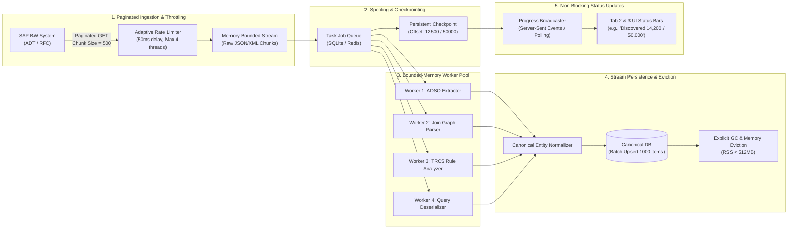

# HANAMORPH BW Migration & Modernization Studio
# Large-Scale Landscape Processing Architecture — Architecture Blueprint 1.0

**Document Reference:** `BW-MIG-SCALE-1.0`  
**Status:** Approved for Architecture Design  
**Target Studio:** `BW_Migration_Studio/bw-studio`  
**Classification:** SAP Enterprise Modernization Architecture  

---

## 1. Challenges of Enterprise BW Scale

An enterprise SAP BW estate typically spans:
- **50,000+** DataSources, InfoObjects, and ADSOs
- **15,000+** Transformations with custom ABAP routines
- **25,000+** BW Queries and analytical views
- Deep 12-layer data lineage trees with circular references

Executing discovery, lineage analysis, and code generation across this volume within a monolithic, synchronous process will cause unhandled memory spikes, network socket timeouts, and browser disconnects.

HANAMORPH implements a **Bounded-Memory Asynchronous Streaming Architecture**.

---

## 2. Processing Pipeline Architecture

### Diagram 7: Large-Landscape Processing Pipeline

---

## 3. Core Processing Patterns & Reliability Guarantees

### 3.1 Bounded-Memory Footprint (Target RSS $\le$ 512 MB)
- **Streaming Parsers:** Raw XML documents returned from ADT endpoints are parsed using iterative SAX/pull parsers (`xml.etree.ElementTree.iterparse`) rather than loading complete DOM trees into memory.
- **Batch Eviction:** Extracted canonical objects are accumulated in fixed-size buffers (1,000 entities) and flushed immediately to the database via bulk `executemany` SQL statements.
- **Garbage Collection:** References are explicitly dropped after batch flushes, ensuring predictable Python heap memory consumption even when processing 100,000+ objects.

### 3.2 Checkpointing, Resume & Crash Recovery
- Every background discovery or generation job is assigned an immutable `job_id`.
- The execution engine writes granular progress records to `job_checkpoints`:
  - `last_processed_object_urn`
  - `completed_count`
  - `failed_count`
  - `status` (`RUNNING`, `PAUSED`, `FAILED`, `COMPLETED`)
- If the application server restarts or network connectivity drops, the job can be resumed from the exact last successful checkpoint without repeating previous extraction cycles.

### 3.3 Idempotency & Backpressure Control
- **Idempotent Upserts:** All canonical database ingestion operations utilize SQLite `ON CONFLICT(urn) DO UPDATE` or PostgreSQL `ON CONFLICT ... DO NOTHING` semantics. Re-running a wave or job never creates duplicate entities or corrupts relationships.
- **Backpressure Regulation:** If the database write latency exceeds 250ms, the worker queue dynamically decreases extraction concurrency from 4 threads to 1 thread until database IO clears.

### 3.4 Job Cancellation & Timeout Safeguards
- Every background task checks a `cancellation_token` before pulling the next batch from the queue.
- Users can cancel long-running discovery sweeps from the UI, halting active SAP HTTP sessions cleanly without leaving orphaned work processes on the source BW system.

---

## 4. The Processing Boundary: Metadata vs. Bulk Business Data

| Processing Dimension | Metadata Processing (Inside HANAMORPH) | Bulk Business Data Movement (External Fabric) |
| :--- | :--- | :--- |
| **Data Structure** | DDIC definitions, join logic, mapping expressions, field schemas. | Millions of transactional records, financial ledger lines, fact table rows. |
| **Execution Engine** | Python asynchronous worker pool (`discovery.py`, `assessment.py`). | SAP Datasphere DP Agent, Replication Flow engine, SAP SLT. |
| **Max Payload Size** | Typically 5 KB – 50 KB per object. | 100 MB – 50 GB+ per business partition. |
| **Network Path** | Local/BTP Host $\rightarrow$ SAP BW Port 443 (ADT GET) or 3300 (RFC). | SAP BW $\rightarrow$ Cloud Connector $\rightarrow$ Datasphere Ingestion Stream. |
| **HANAMORPH Role** | Ingests, normalizes, analyzes, scores, and generates targets. | Generates the `.flow.json` replication configuration and verifies external status. |

> [!IMPORTANT]
> **Strict Architecture Rule:** Under no circumstance does the HANAMORPH Python process download, buffer, or transform raw business data records from source tables (`/BIC/A*`, `/BI0/F*`). Doing so would violate enterprise data governance, breach GDPR/PII compliance boundaries, and cause instant Out-Of-Memory (OOM) failures.
