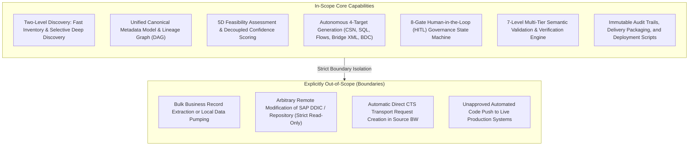
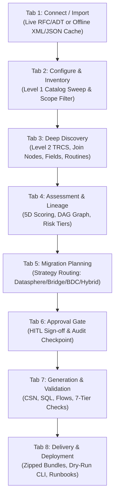

# HANAMORPH BW Migration & Modernization Studio
# Master Product Requirements Document (PRD) — Architecture Blueprint 1.0

**Document Reference:** `BW-MIG-PRD-1.0`  
**Status:** Approved for Architecture Design  
**Target Studio:** `BW_Migration_Studio/bw-studio`  
**Classification:** SAP Enterprise Modernization Architecture  

---

## 1. Executive Summary & Product Vision

### 1.1 Purpose
The **HANAMORPH BW Migration & Modernization Studio** is an enterprise-grade automated discovery, assessment, translation, planning, and validation platform. It empowers enterprises to modernize legacy SAP Business Warehouse (SAP BW 7.4/7.5, SAP BW/4HANA, S21 baselines, and SAP S/4HANA embedded BW) into next-generation target architectures:
1. **SAP Datasphere** (Native Cloud Data Warehouse & Business Semantic Fabric)
2. **SAP BW Bridge** (Cloud-hosted BW modernization layer on SAP BTP)
3. **SAP Business Data Cloud (BDC)** (Data Products and Data Sharing Cockpit integration)
4. **Hybrid Modernization Architecture** (Coexistence, phased delta cutover, dual-run orchestration)

### 1.2 Core Architectural Invariant: Metadata vs. Bulk Business Data
> [!IMPORTANT]
> **The Data Processing Invariant:**
> HANAMORPH operates exclusively as a **Metadata and Logic Modernization Engine**. HANAMORPH ingests, structures, analyzes, plans, and generates code from SAP BW metadata. It **NEVER** downloads, processes, or stores bulk business records inside its application memory or database layer.
>
> All actual business data movement (delta loads, initial loads, and Change Data Capture) is orchestrated through official SAP-native transport and replication technologies:
> - SAP Datasphere Replication Flows (with source Change Log CDC)
> - SAP Datasphere Transformation Flows and Data Flows
> - SAP Data Intelligence Cloud / SAP Landscape Transformation (SLT)
> - SAP BTP Cloud Integration and ODP extraction pipelines

---

## 2. Target Personas & Stakeholder Journeys

| Persona | Role & Objectives | Key Interactions in HANAMORPH |
| :--- | :--- | :--- |
| **SAP BW / Migration Architect** | Oversees landscape transition, defines wave cutover plans, determines target route per object. | Evaluates 5D assessment scores, reviews topology DAG, assigns target routes (Datasphere vs. Bridge vs. BDC). |
| **BW & Datasphere Developer** | Reviews generated target artifacts, inspects routine transformations, inspects SQL DDL. | Inspects CSN models, views graphical DDL, reviews ABAP routine translation, verifies joins and measures. |
| **Enterprise Data Governance Lead** | Enforces security, ensures lineage traceability, signs off on data product definitions. | Approves migration gates, reviews data privacy tags, audits least-privilege technical access, validates lineage. |
| **QA & Reconciliation Lead** | Verifies semantic parity, confirms data consistency between source and target systems. | Executes 7-tier validation, reviews external replication checksums, inspects currency/unit consistency reports. |
| **Program Manager / Delivery Lead** | Tracks project delivery milestones, estimates migration hours, manages deployment packages. | Monitors migration waves, downloads unified deployment bundles, audits sign-offs. |

---

## 3. Product Scope & Functional Boundaries

### 3.1 Supported Source Systems & Releases
- **SAP BW 7.40 / 7.50 on SAP HANA** (SP08 through SP26+)
- **SAP BW 7.50 on AnyDB** (Assessment and Bridge/Datasphere extraction route)
- **SAP BW/4HANA 1.0, 2.0, 2021, and 2023**
- **SAP S21 Reference Landscape** (Dedicated read-only test & benchmark system)
- **SAP S/4HANA Embedded BW** (CDS Analytical Views, Virtual Data Models)

### 3.2 Target Strategy Coverage Matrix
- **Native SAP Datasphere:**
  - Local Tables (`entity`), Graphical & SQL Views (`view`), Analytic Models (`@Analytics.dataCategory: "CUBE"`).
  - HANA Cloud Column Tables & Views DDL.
  - Replication Flow JSON definitions (`.flow.json`) and Transformation Flow contracts.
- **SAP BW Bridge:**
  - Standard ADSO and InfoObject abapGit XML conversion packages.
  - BTP ABAP destination mappings and supported transformation routine wrappers.
- **SAP Business Data Cloud (BDC):**
  - BW Data Subscriptions, BW file space models, Data Product manifests (`data-product.json`).
  - Integration with SAP Data Sharing Cockpit.
- **Hybrid Modernization:**
  - Dual-run delta replication configurations, Change Log CDC mapping, cutover orchestrations.

---

## 4. End-to-End User Experience & 8-Tab Workflow Mapping

The Studio maps seamlessly to the existing 8-tab single-page interface without breaking UI bindings:

### 4.1 Tab Mapping Specifications
1. **Connect / Import (Tab 1):** Multi-system connection selector (BW S21, Datasphere, BTP, HANA Cloud, Cloud Foundry). Status indicators (`CONNECTED`, `NOT CONFIGURED`, `FAILED`), offline metadata upload dropzone.
2. **Configure & Inventory (Tab 2):** Fast landscape catalog viewer. Filters by InfoArea, Object Type (ADSO, CP, IO, TRFN, DTP, Query), Active Status. Scope selector for Deep Discovery.
3. **Deep Discovery (Tab 3):** Detailed hierarchy tree. Inspects field dimensions, compounding parents, currency/unit assignments, join topology, and transformation logic.
4. **Assessment & Lineage (Tab 4):** Interactive DAG visualization (Kahn's topological sort). 5-dimension score breakdown, confidence score, 4-tier risk matrix (`LOW`, `MEDIUM`, `HIGH`, `CRITICAL`), and routine complexity.
5. **Migration Planning (Tab 5):** Target strategy selection per object or wave. Wave grouping based on dependency levels. Resource estimation.
6. **Approval Gate (Tab 6):** Formal Human-in-the-Loop review pane. Mandatory architect sign-off, comment log, rollback contingency documentation, cryptographic audit fingerprint.
7. **Generation & Validation (Tab 7):** Code generation preview (CSN 2.0, HANA SQL DDL, Replication Flow JSON, abapGit XML). Real-time 7-tier validation runner with syntax, semantic, and referential checks.
8. **Delivery & Deployment (Tab 8):** Final deployment package builder. Generates CLI deployment scripts (`deploy_datasphere.sh`, `deploy_hana.sql`), manifest files, data replication runbooks, and delivery validation reports.

---

## 5. Non-Functional Requirements (NFRs)

### 5.1 Security & Zero-Modification S21 Invariant
- **Strict Read-Only Enforcement:** Zero HTTP mutating verbs (`POST`, `PUT`, `DELETE`), zero RFC mutating BAPIs, zero CTS transport requests.
- **Credential Storage:** AES-256-GCM encryption for stored secrets; environment isolation; credentials never exposed in logs or UI responses.
- **Least Privilege:** Enforces dedicated technical communication user (`Z_BW_MIGRATION_READ`) with read-only DDIC and ADT scopes.

### 5.2 Performance & Scalability
- **Landscape Capacity:** Handles up to 100,000 BW metadata entities across 1,000 InfoAreas without UI degradation.
- **Bounded In-Memory Consumption:** Discovery and generation engines process via paginated cursor streams with maximum RSS memory capped at 512MB.
- **Source Protection:** ADT and RFC calls are throttled with configurable sleep intervals (default 50ms) to ensure zero impact on production BW Dialog work processes.

### 5.3 Reliability & Auditability
- **Idempotency:** Re-running discovery or generation with identical inputs produces bit-for-bit identical canonical models and target code.
- **Full Provenance:** Every canonical field and model retains source extraction timestamp, SAP release version, extractor adapter identity, and hash fingerprint.

---

## 6. Official SAP References & Architectural Standards
- **SAP Datasphere Help Portal:** [SAP Datasphere Modeling](https://help.sap.com/docs/SAP_DATASPHERE)
- **SAP BW Bridge Overview:** [SAP BW Bridge Documentation](https://help.sap.com/docs/SAP_BW_BRIDGE)
- **SAP BW/4HANA Modernization Guide:** [SAP BW/4HANA Modernization](https://help.sap.com/docs/SAP_BW4HANA)
- **SAP Business Data Cloud (BDC) Integration:** [BW Data Product Generator](https://help.sap.com/docs/SAP_BW4HANA/ed919380760a44388ab90e6bb3e7480a)
