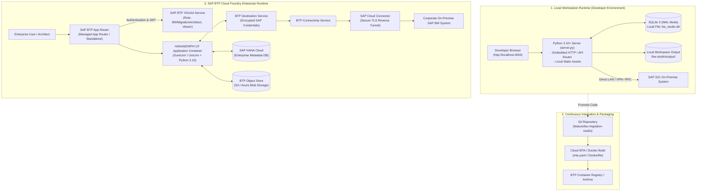

# HANAMORPH BW Migration & Modernization Studio
# Security & Deployment Architecture: Local to SAP BTP Cloud Foundry — Architecture Blueprint 1.0

**Document Reference:** `BW-MIG-SEC-1.0`  
**Status:** Approved for Architecture Design  
**Target Studio:** `BW_Migration_Studio/bw-studio`  
**Classification:** SAP Enterprise Modernization Architecture  

---

## 1. Security Architecture & Threat Mitigation

### 1.1 Non-Negotiable S21 Read-Only Enforcement
Because the SAP user **`int_samarth`** holds unrestricted `SAP_ALL` administrative authorizations on SAP benchmark system **`S21`** (Client 200), HANAMORPH implements defense-in-depth security to guarantee that zero mutating operations reach the SAP landscape:
1. **HTTP Verb Jail:** The HTTP client layer hardcodes an invariant check: only `GET` and `HEAD` methods are executed. Any call attempting `POST`, `PUT`, `PATCH`, or `DELETE` against an SAP endpoint raises an unrecoverable `SecurityViolationException`.
2. **CTS Transport Block:** No function modules capable of generating or modifying CTS Workbench / Customizing Transport Requests (`TRINT_*`, `TR_REQUEST_*`) exist in the adapter whitelist.
3. **DDIC Write Protection:** The application never generates or invokes ABAP DDIC activation APIs on remote SAP systems.
4. **Least-Privilege Role Profile:** The studio provides automated generation of the `Z_BW_MIGRATION_READ` authorization role, allowing enterprise security teams to replace `SAP_ALL` with a strictly scoped technical communication user.

### 1.2 Path Traversal & Static Asset Jail
To protect the local workstation and cloud container filesystem, `server.py` enforces a strict jail root:
- The base path is resolved as `os.path.abspath(PUBLIC_DIR)`.
- Every incoming static file request is sanitized:
  ```python
  safe_path = os.path.abspath(os.path.join(PUBLIC_DIR, req_path.lstrip("/")))
  if not safe_path.startswith(PUBLIC_DIR):
      raise PermissionError("Path traversal attempt detected")
  ```
- Attempted traversals (`../../`, encoded `%2e%2e%2f`) are immediately blocked with HTTP 403 Forbidden.

### 1.3 Secret Protection & Credential Encryption
- Secret environment variables (`SAP_PASSWORD`, `BTP_SERVICE_KEY`, `DSP_CLIENT_SECRET`) are never persisted in plaintext database tables.
- Stored credentials are encrypted using **AES-256-GCM** with a 256-bit key derived via PBKDF2 with 100,000 iterations.
- Logging filters sanitize all outbound and inbound HTTP/RFC logs, replacing sensitive tokens and passwords with `[REDACTED]`.

---

## 2. Deployment Architecture: Local to SAP BTP Cloud Foundry

HANAMORPH is engineered with a dual-target deployment model:
1. **Local Developer Workstation Mode** (Standalone Python HTTP server running on `localhost:4004`).
2. **SAP BTP Cloud Foundry Enterprise Mode** (Multi-tenant containerized microservice integrated with SAP Cloud Connector and XSUAA).

### Diagram 16: Local-to-BTP Cloud Foundry Deployment Pipeline



---

## 3. SAP BTP Deployment Descriptor Specifications

### 3.1 Multi-Target Application Descriptor (`mta.yaml`)
```yaml
_schema-version: '3.1'
ID: hanamorph-bw-migration-studio
version: 1.0.0
description: "HANAMORPH BW Migration & Modernization Studio"

modules:
  - name: hanamorph-bw-studio-app
    type: python
    path: .
    parameters:
      disk-quota: 1024M
      memory: 1024M
    build-parameters:
      builder: custom
      commands:
        - pip install -r requirements.txt
    provides:
      - name: hanamorph-app-api
        properties:
          url: '${default-url}'
    requires:
      - name: hanamorph-uaa
      - name: hanamorph-dest
      - name: hanamorph-connectivity
      - name: hanamorph-hana-cloud

resources:
  - name: hanamorph-uaa
    type: org.cloudfoundry.managed-service
    parameters:
      service: xsuaa
      service-plan: application
      path: ./xs-security.json

  - name: hanamorph-dest
    type: org.cloudfoundry.managed-service
    parameters:
      service: destination
      service-plan: lite

  - name: hanamorph-connectivity
    type: org.cloudfoundry.managed-service
    parameters:
      service: connectivity
      service-plan: lite

  - name: hanamorph-hana-cloud
    type: org.cloudfoundry.managed-service
    parameters:
      service: hana
      service-plan: hdi-shared
```

### 3.2 Cloud Foundry Manifest (`manifest.yml`)
```yaml
applications:
  - name: hanamorph-bw-studio
    memory: 1024M
    disk_quota: 1024M
    instances: 2
    buildpacks:
      - python_buildpack
    command: gunicorn -w 4 -k uvicorn.workers.UvicornWorker server:app --bind 0.0.0.0:$PORT
    env:
      ENVIRONMENT: production
      LOG_LEVEL: INFO
      STORAGE_BACKEND: btp_hana
      READ_ONLY_ENFORCEMENT: "true"
```

---

## 4. Disaster Recovery & Business Continuity
- **Zero Business Data Exposure:** Because HANAMORPH stores only metadata models and target code specifications, a database loss does not impact transactional ERP/BW records.
- **Repository Backup:** In BTP Cloud Foundry, automated point-in-time recovery (PITR) of the metadata database runs every 24 hours.
- **Stateless Application Tier:** Cloud Foundry instances are horizontally stateless; any failing container can be instantly recreated without project state loss.
