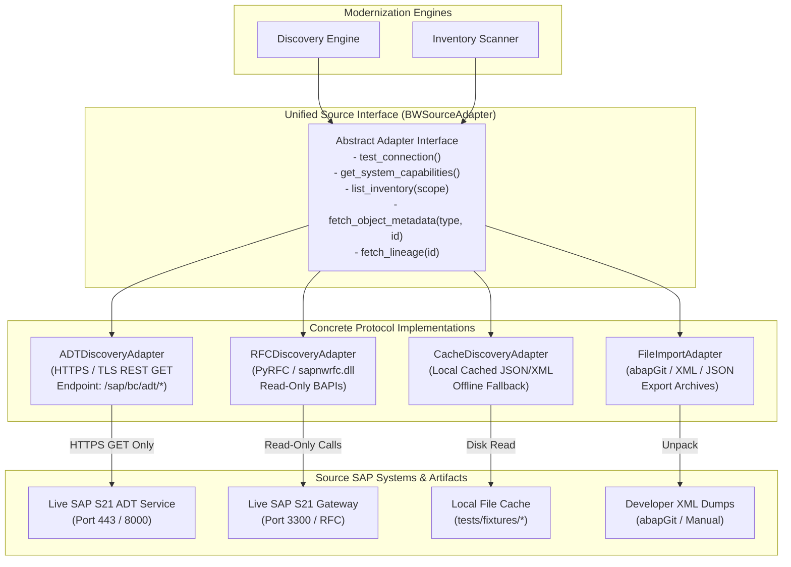
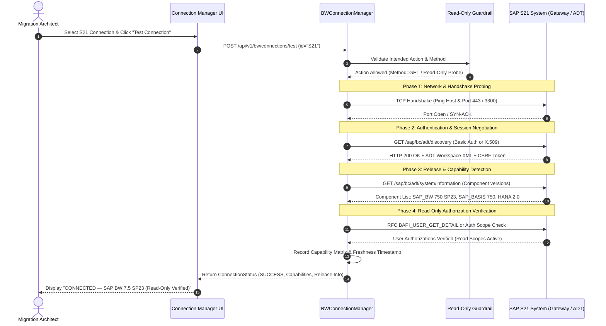
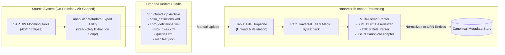

# HANAMORPH BW Migration & Modernization Studio
# Source Connectivity Architecture — Architecture Blueprint 1.0

**Document Reference:** `BW-MIG-CONN-1.0`  
**Status:** Approved for Architecture Design  
**Target Studio:** `BW_Migration_Studio/bw-studio`  
**Classification:** SAP Enterprise Modernization Architecture  

---

## 1. Multi-Protocol Source Connectivity Abstraction

SAP BW landscapes exhibit significant heterogeneity across versions (BW 7.4, 7.5, BW/4HANA), database layers (HANA, Oracle, DB2, MS SQL), and exposed interface protocols. HANAMORPH implements a unified **Source Connectivity Adapter Pattern** that abstracts connection details behind a standardized interface: `BWSourceAdapter`.



---

## 2. Live BW Connection Flow

Live connectivity is governed by strict authentication, capability probing, and read-only validation before any metadata query is permitted.

### Diagram 3: Live BW Connection Sequence



---

## 3. Metadata Import Architecture (Offline Mode)

When live network connectivity to an on-premise BW system is prohibited by firewall policies, HANAMORPH supports complete offline migration through structured metadata archives.

### Diagram 4: Metadata Import Pipeline



---

## 4. Strict Read-Only S21 Guardrail Enforcement

### 4.1 Threat Model & System Vulnerability
The SAP user **`int_samarth`** possesses full administrative authorization (**`SAP_ALL`**) on SAP reference system **`S21`** (Client 200). Any unmitigated `POST`, `PUT`, `DELETE`, or executing write-enabled Function Modules (such as `RS_TRANSACTION_SAVE` or `TR_TRANSPORT_REQUEST_CREATE`) would alter the production repository or trigger unintended CTS workbench transports.

### 4.2 Architectural Enforcement Mechanisms
1. **Network Layer Isolation:**
   - Outbound HTTP requests from `BWConnectionManager` strictly disallow HTTP methods other than `GET` and `HEAD`. Any invocation with `POST`, `PUT`, `PATCH`, or `DELETE` throws a fatal `ForbiddenOperationError` before hitting the socket.
2. **ADT URI Whitelisting:**
   - Only documented read-only ADT endpoints are accessible:
     - `/sap/bc/adt/discovery`
     - `/sap/bc/adt/repository/nodestructure`
     - `/sap/bc/adt/bw/modeling/*` (GET only)
     - `/sap/bc/adt/ddic/*` (GET only)
3. **RFC Function Module Whitelisting:**
   - RFC calls through PyRFC/`sapnwrfc.dll` are restricted to a strictly bounded whitelist:
     - `RFC_READ_TABLE` (with query constraints)
     - `BAPI_USER_GET_DETAIL`
     - `RSO_OBJECT_GET_INFO`
     - `RS_DTP_GET_DETAIL` (read mode only)
   - Mutating function modules (e.g., `BAPI_TRANSACTION_COMMIT`, `TRINT_*`, `BAPI_ADSO_*`) are blocked at the adapter dispatch layer.
4. **Proposed Least-Privilege Technical Communication User:**
   - For enterprise production deployments, the `SAP_ALL` account must be superseded by a dedicated non-dialog technical user: **`Z_BW_MIGRATION_READ`**.

```abap
" Recommended Least-Privilege Authorization Profile for Z_BW_MIGRATION_READ
AUTHORIZATION OBJECT 'S_RFC'
  ACTVT: '16' (Execute)
  RFC_NAME: 'RFC_READ_TABLE', 'BAPI_USER_GET_DETAIL', 'RSO_*', 'RS_DTP_*'
  RFC_TYPE: 'FUGR'

AUTHORIZATION OBJECT 'S_ADT_RES'
  ACTVT: '03' (Display)
  URI: '/sap/bc/adt/*'

AUTHORIZATION OBJECT 'S_RS_ADSO'
  ACTVT: '03' (Display)
  RSADSO: '*'

AUTHORIZATION OBJECT 'S_TABU_DIS'
  ACTVT: '03' (Display)
  DICBERCLS: '&NC&', 'SS' (System and Repository Tables)
```

---

## 5. Source System Capability & Release Auto-Detection

Upon initial handshake, `BWConnectionManager` automatically probes the system version to dynamically configure extraction capabilities:

| Release Detected | Component Versions | Supported Native Interfaces | Modernization Feature Availability |
| :--- | :--- | :--- | :--- |
| **BW 7.4 on HANA** | SAP_BW 740 SP12+, SAP_BASIS 740 | RFC, DB Views, Classical ADT | Advanced DSOs (Early format), CompositeProviders (HANA Studio format), Legacy InfoCubes. |
| **BW 7.5 on HANA** | SAP_BW 750 SP08–SP26+, SAP_BASIS 750 | ADT REST API, RFC, ODP OData | Standard ADSOs, CompositeProviders (Full SQL joins), Navigational Attributes, Currency Conversion Types. |
| **BW/4HANA 2.0 / 2021** | DW4CORE 200/300, SAP_BASIS 755+ | Modern ADT REST, OData v4, CDS | Core Data Services, Native Datasphere Integration, BW Data Product Generator (BDC). |
| **SAP S21 Baseline** | SAP_BW 750 SP23 (Client 200) | ADT, RFC Gateway (Port 3300) | Fully validated test harness: ADSO `ZSAM_SO01`, CompositeProvider `ZSAM_SO_CP`. |

---

## 6. Credential Storage & Security Governance
- In local development, credentials reside strictly within a local `.env` file excluded by `.gitignore`.
- Secrets are encrypted at rest using AES-256-GCM with a key derived via PBKDF2 (SHA-256, 100,000 iterations).
- Tokens and passwords are never returned over API endpoints, written to log files, or persisted in SQLite tables.
