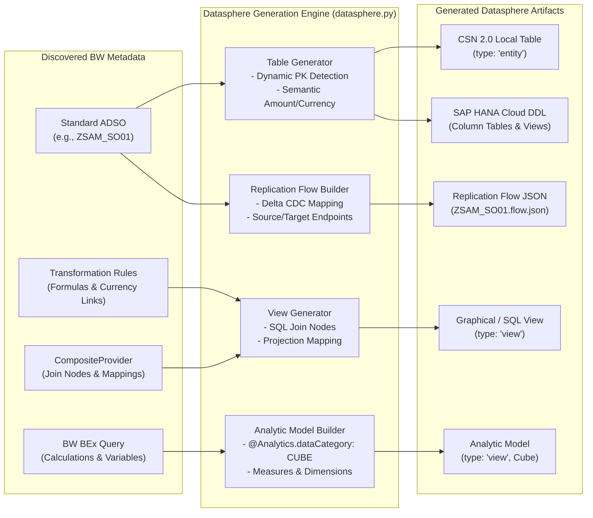
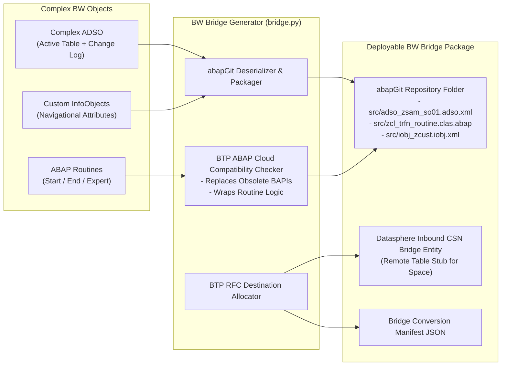
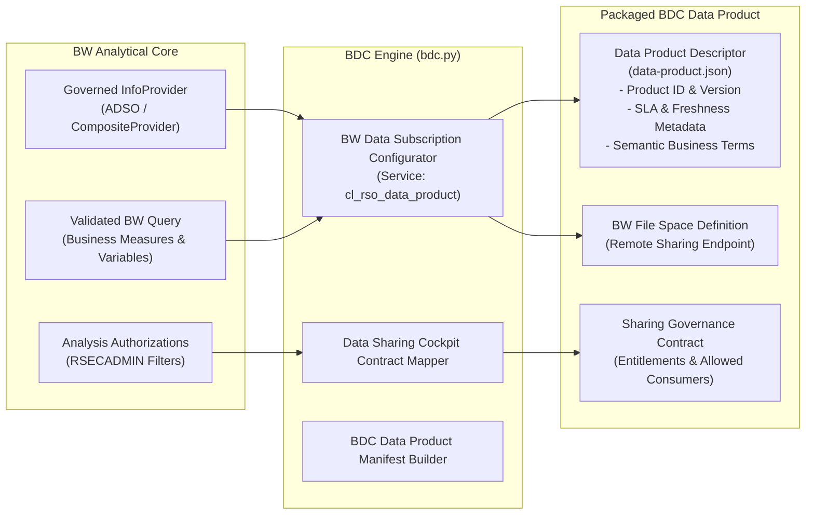
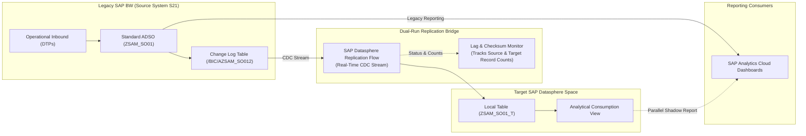
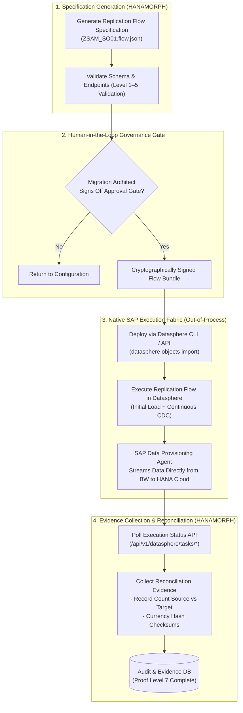

# HANAMORPH BW Migration & Modernization Studio
# Target Modernization Strategies Architecture — Architecture Blueprint 1.0

**Document Reference:** `BW-MIG-TARG-1.0`  
**Status:** Approved for Architecture Design  
**Target Studio:** `BW_Migration_Studio/bw-studio`  
**Classification:** SAP Enterprise Modernization Architecture  

---

## 1. Overview of the Four Target Modernization Routes

Enterprise modernization cannot follow a "one-size-fits-all" path. Depending on legacy complexity, ABAP footprint, analytical consumption, and target cloud landscape, HANAMORPH provides four autonomous target generation routes:
1. **Route 1: Native SAP Datasphere Route** (Pure cloud semantic fabric and SQL data warehouse)
2. **Route 2: SAP BW Bridge Route** (ABAP-hosted BW modernization container on SAP BTP)
3. **Route 3: SAP Business Data Cloud (BDC) Route** (Packaged Data Products and Data Sharing Cockpit)
4. **Route 4: Hybrid Modernization Route** (Dual-run coexistence, Change Log CDC, staged cutover)

---

## 2. Route 1: Native SAP Datasphere Architecture

The Native Datasphere route generates pure Core Data Services CSN 2.0 artifacts, HANA Cloud SQL DDL, and Replication Flow definitions, completely eliminating legacy ABAP runtimes.

### Diagram 9: Native Datasphere Target Route

### 2.1 Artifact Specifications & Official SAP Documentation Anchors
- **CSN 2.0 Schema Definition:** Local Tables are emitted as `@EndUserText.label` annotated CDS entities with explicit semantic associations (`@Semantics.amount.currencyCode`).
- **SAP Reference:** [SAP Datasphere Modeling Documentation](https://help.sap.com/docs/SAP_DATASPHERE/c8a5410afbbf4928ac78477215c0e178/e6b22c8cb93845dc8a113ecaa68a62f5.html).
- **SAP HANA Cloud DDL:** High-performance Column Tables with `PRIMARY KEY` constraints and foreign key annotations matching the CSN entity.
- **Replication Flows (`.flow.json`):** Captures source connection names, source container paths, target space names, delta load type (`DeltaWithInitialLoad`), and Change Log CDC mappings.

---

## 3. Route 2: SAP BW Bridge Architecture

For workloads containing business-critical legacy ABAP routines (Start, End, or Field routines) that cannot be immediately rewritten into SQL, the **SAP BW Bridge** route provides a safe harbor on SAP BTP.

### Diagram 10: SAP BW Bridge Target Route

### 3.1 Conversion Capabilities & Technical Prerequisites
- **Supported Objects:** Standard ADSOs with change log, InfoObjects, Transformations, and DTPs.
- **ABAP Language Version:** Generated routine wrappers are verified against **ABAP for Cloud Development** (Restricted ABAP syntax; zero direct OS or memory access).
- **SAP Reference:** [SAP BW Bridge Modeling Guide](https://help.sap.com/docs/SAP_BW_BRIDGE/0eec0d68141541d1b07893a39944924e/e6fd7e3e46e84d4da58df4c8a2455e92.html).

---

## 4. Route 3: SAP Business Data Cloud (BDC) Architecture

SAP Business Data Cloud (BDC) provides federated semantic sharing without forcing data movement through the **BW Data Product Generator** and **Data Sharing Cockpit**.

### Diagram 11: BDC Data Product Target Route

### 4.1 Technical Specifications & Official SAP Citations
- **Integration Class:** Employs the official SAP BW/4HANA Data Product generation interface: `CL_RSO_DATA_PRODUCT`.
- **Consumer Protocol:** Exposed over OData v4 and SAP Datasphere Data Sharing Cockpit contracts.
- **SAP Reference:** [SAP BW/4HANA Data Product Integration](https://help.sap.com/docs/SAP_BW4HANA/ed919380760a44388ab90e6bb3e7480a).

---

## 5. Route 4: Hybrid Modernization Architecture

Enterprise migrations span months of coexistence. The Hybrid route orchestrates dual-run replication, Change Log CDC streams, and phased cutovers.

### Diagram 12: Hybrid Target Route

---

## 6. External Data Movement & Orchestration

> [!IMPORTANT]
> **Strict Operational Boundary:** HANAMORPH never acts as the bulk data mover. It defines the flow specifications and monitors execution state via native SAP APIs.

### Diagram 13: External Data Movement & Orchestration Pipeline

