# HANAMORPH BW Migration & Modernization Studio
# Multi-Tier Validation & Reconciliation Architecture — Architecture Blueprint 1.0

**Document Reference:** `BW-MIG-VAL-1.0`  
**Status:** Approved for Architecture Design  
**Target Studio:** `BW_Migration_Studio/bw-studio`  
**Classification:** SAP Enterprise Modernization Architecture  

---

## 1. Overview of the 7-Tier Validation Framework

Validation in HANAMORPH is organized into seven progressive tiers. Tiers 1 through 5 run entirely locally within the modernization engine without requiring external SAP system interaction. Tiers 6 and 7 ingest and evaluate evidence generated from external execution runs.

---

## 2. Validation & Reconciliation Pipeline

### Diagram 15: 7-Level Validation & Reconciliation Framework

```mermaid
flowchart TD
    subgraph IN_ENGINE_VALIDATION["In-Engine Semantic & Syntactic Verification (Local / Zero Risk)"]
        direction TB
        L1["Level 1: Syntactic Artifact Validation\n- CSN 2.0 JSON Schema Compliance\n- HANA Cloud SQL DDL AST Parsing\n- Replication Flow JSON Validation"]
        L2["Level 2: Field & DataType Compatibility\n- Primary Key Preservation\n- Lossless ABAP-to-CDS Type Conversion\n- Precision & Scale Alignment"]
        L3["Level 3: Referential & Semantic Integrity\n- Currency/Unit Linkage Verification\n- Compounding Key Invariant Checks\n- Measure Aggregation Semantics"]
        L4["Level 4: Dependency Graph Topological Closure\n- Upstream Provider Existence\n- No Broken Foreign Links\n- Wave Sequencing Verification"]
        L5["Level 5: Delta & CDC Mode Equivalence\n- Change Log Activation Check\n- Delta Capability Match (DeltaWithInitialLoad)"]

        L1 --> L2 --> L3 --> L4 --> L5
    end

    subgraph HITL_GATE["Human-in-the-Loop Sign-off"]
        L5 --> APPROVE_EXEC{"Pass Levels 1-5?\nAuthorize External Run"}
    end

    subgraph EXTERNAL_EVIDENCE_VALIDATION["External Execution Evidence Ingestion (Out-of-Process Proofs)"]
        direction TB
        APPROVE_EXEC -- Yes --> L6["Level 6: External Dry-Run & Schema Compatibility\n- Datasphere CLI / API Dry-Run Import\n- Space Metadata Verification (No Data Moved)"]
        L6 --> EXT_FLOW["Execute External Replication Flow in Datasphere"]
        EXT_FLOW --> L7["Level 7: Data Reconciliation & Business Parity Evidence\n- Ingest Source vs Target Record Counts\n- Aggregate Measure Totals (e.g., Net Sales Sum)\n- Checksum Hash Comparison (Zero Data Ingested)"]
    end

    subgraph AUDIT_RECON["Reconciliation Sign-Off"]
        L7 --> RECON_REPORT["Generate Final Reconciliation Certificate\n(Pass / Flag Variance / Audit Log)"]
    end
```

---

## 3. Deep Dive into the 7 Validation Levels

### Level 1: Syntactic Artifact Validation
- **CSN Schema Checker:** Validates generated CSN JSON documents against official SAP Core Data Services CSN 2.0 JSON Schema specifications (`definitions`, `elements`, `type`).
- **SQL DDL AST Parser:** Tokenizes and parses generated SAP HANA Cloud SQL DDL using an Abstract Syntax Tree (AST) parser to ensure strict compliance with SAP HANA Cloud SQL syntax (validating `CREATE COLUMN TABLE`, data type notations, and constraints).

### Level 2: Field & DataType Compatibility
- Verifies that every source field in the canonical ADSO or CompositeProvider exists in the target entity.
- Ensures no loss of precision: e.g., ABAP `DEC(15,2)` maps to `cds.Decimal(15,2)`; ABAP `DATS` maps to `cds.Date`.
- Verifies that all primary key fields in standard ADSOs are preserved as `key: true` in target CSN entities.

### Level 3: Referential & Semantic Integrity
- **Currency/Unit Integrity Check:** For every measure field with semantic type `AMOUNT` (e.g., `NET_AMOUNT`), verifies that `@Semantics.amount.currencyCode` links to a valid qualifying field (e.g., `CURRENCY_CODE`) defined in the same entity or an associated dimension.
- **Compounding Parent Check:** Validates that compounding master data attributes have their parent dimension included in the primary key to prevent duplicate record collisions.

### Level 4: Dependency Graph Topological Closure
- Verifies that all upstream providers required by a CompositeProvider or View have been generated in the current or an earlier migration wave.
- Flags any "orphaned" join nodes or unmapped source fields before artifacts are packaged.

### Level 5: Delta & CDC Mode Equivalence
- Evaluates whether the source ADSO has an active Change Log.
- If an ADSO has an active Change Log, verifies that the generated Replication Flow specifies `DeltaWithInitialLoad`.
- If an ADSO is direct-write or staging-only without a Change Log, enforces a full-refresh extraction strategy or requires a business timestamp filter.

### Level 6: External Dry-Run & Schema Compatibility
- Executes a non-mutating dry-run command via the SAP Datasphere CLI or REST API:
  `datasphere objects validate --space <SPACE_ID> --file <PATH>`
- Confirms space quotas, naming collision absence, and authorization without persisting records.

### Level 7: Data Reconciliation & Business Parity Evidence

> [!IMPORTANT]
> **Data Reconciliation Invariant:** Level 7 validation does NOT download table rows into Python to compare them row-by-row. Instead, it queries summary metrics from both source and target via native read-only queries or API monitors.

1. **Record Count Equality:**
   $$\text{Count}(BW\_Source\_Active) \equiv \text{Count}(Datasphere\_Target)$$
2. **Key Metric Sum Reconciliation:**
   $$\left| \sum (BW.NetRevenue) - \sum (Datasphere.NetRevenue) \right| < 0.001$$
3. **Reconciliation Certificate:** The results are serialized into an immutable JSON evidence file (`validation_reconciliation_report.json`) signed by the QA Lead.
