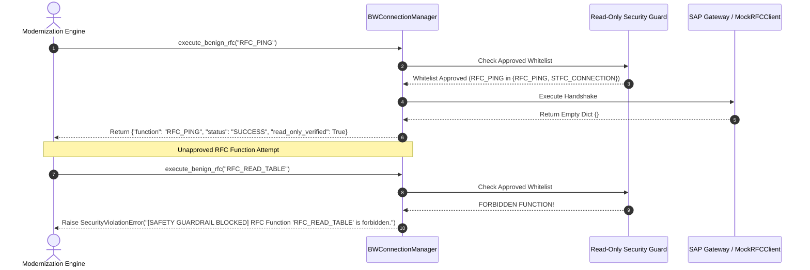

# HANAMORPH BW Migration & Modernization Studio
# Milestone M1.5: Connection Security Boundaries & Benign RFC Diagnostics

**Document Reference:** `BW-MIG-M1-SEC`  
**Status:** Implemented & Verified (5/5 Tests Passing)  
**Target Studio:** `BW_Migration_Studio/bw-studio/connectors/bw_connection_manager.py`  
**Classification:** SAP Enterprise Modernization Security Deliverable  
**Date:** November 21, 2026  

---

## 1. Overview & Security Mandate

Milestone M1.5 implements defense-in-depth security hardening for source SAP BW connectivity, specifically addressing the administrative privileges of user `int_samarth` (`SAP_ALL`) on SAP reference system `S21`.

### Non-Negotiable Invariants Enforced:
1. **HTTP Verb Jail:** Outbound HTTP client hardcodes an invariant check permitting only `GET` and `HEAD` methods. Invocations of `POST`, `PUT`, `DELETE`, `PATCH`, or `TRACE` immediately raise `SecurityViolationError`.
2. **Forbidden Path Shield:** Blocks URL paths associated with repository mutation: `/cts/`, `/transports`, `/activate`, `/lock`, `/create`, `/delete`.
3. **Benign RFC Whitelist:** Prohibits `RFC_READ_TABLE`, `BAPI_USER_GET_DETAIL`, and any write-enabled function modules. Supports exclusively approved benign diagnostics:
   - `RFC_PING`: Verifies TCP network and SAP gateway connectivity.
   - `STFC_CONNECTION`: Verifies RFC session integrity and parameter echo.
4. **Offline Mock Client (`MockRFCClient`):** Enables 100% offline unit/integration test coverage of benign RFC execution without physical SAP NetWeaver dependencies or proprietary DLLs.
5. **Credential Masking:** Passwords and tokens are strictly redacted (`[REDACTED]`) from logs, error strings, and JSON status payloads.

---

## 2. Interface Execution Flow

---

## 3. Verified Test Evidence

The security boundaries are validated by `test_m1_connectivity_security.py`:
- `test_http_mutating_verbs_strictly_blocked`: Confirms POST, PUT, DELETE, PATCH, TRACE are all rejected.
- `test_forbidden_sap_endpoints_blocked`: Confirms CTS transport, activation, lock, and create paths are rejected.
- `test_credential_sanitization_in_status_and_errors`: Verifies plaintext password never leaks in status dictionaries.
- `test_benign_rfc_diagnostics_succeed`: Verifies `RFC_PING` and `STFC_CONNECTION` succeed with mock client.
- `test_unapproved_rfcs_strictly_blocked`: Confirms `RFC_READ_TABLE`, `BAPI_USER_GET_DETAIL`, `TRINT_CREATE_TR`, and `RS_DTP_ACTIVATE` are immediately blocked.
