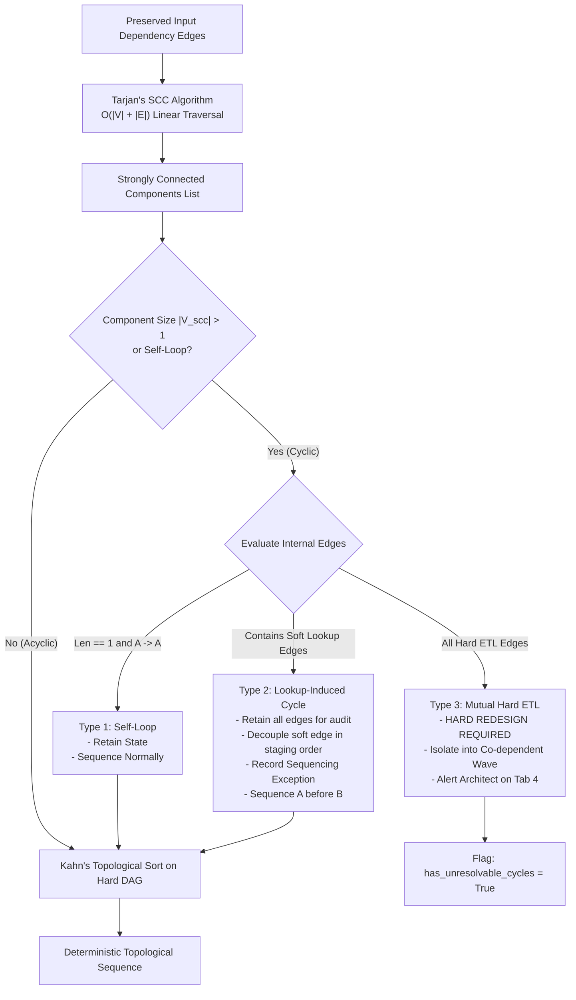

# HANAMORPH BW Migration & Modernization Studio
# Milestone M1.6: Dependency Graph & Cycle Analysis Engine

**Document Reference:** `BW-MIG-M1-GRAPH`  
**Status:** Implemented & Verified (5/5 Tests Passing)  
**Target Studio:** `BW_Migration_Studio/bw-studio/dependency_engine/dependency_graph.py`  
**Classification:** SAP Enterprise Modernization Engineering Deliverable  
**Date:** November 21, 2026  

---

## 1. Overview & Algorithmic Rationale

In legacy SAP BW landscapes, transformations and routine lookups frequently create cyclical relationships that break standard topological sorting algorithms (such as Kahn's algorithm), causing sequencing pipelines to fail or deadlock.

Milestone M1.6 implements a deterministic **Cycle Analysis & Edge Classification Engine**:
1. **Tarjan's Strongly Connected Components (SCC) Algorithm:** Detects all maximal cyclical subgraphs in linear time $\mathcal{O}(|V| + |E|)$.
2. **Edge Classification:** Distinguishes **Hard ETL Dependencies** (`EXTRACTS_INTO`, `PART_PROVIDER`, `DATA_FLOW`) from **Soft Lookup Dependencies** (`LOOKUP_ROUTINE`, `MASTER_DATA_READ`, `SEMANTIC_LINK`).
3. **Strict Edge Preservation Invariant:** Every original dependency edge is preserved in the data model and reported in audit outputs. Zero edges are deleted or discarded.
4. **Deterministic Cycle Resolution:**
   - *Type 1 (Self-Loop, $A \rightarrow A$):* Bypassed in topological ordering; marked as in-memory accumulator.
   - *Type 2 (Lookup-Induced, $A \xrightarrow{\text{hard}} B \xrightarrow{\text{soft}} A$):* Decouples the soft lookup edge for topological wave sequencing. Emits a formal **Sequencing Exception** requiring runtime late-binding or two-pass execution.
   - *Type 3 (Mutual Hard ETL, $A \xrightarrow{\text{hard}} B \xrightarrow{\text{hard}} A$):* Cannot be topologically sequenced. Flagged with `manual_redesign_required = True` for human architect restructuring.

---

## 2. Cycle Analysis Pipeline

---

## 3. Verified Test Evidence

The cycle analysis engine is validated by `test_m1_dependency_cycle.py`:
- `test_acyclic_graph_topological_sort`: Validates clean linear sequencing ($DS \rightarrow ADSO \rightarrow CP \rightarrow QRY$).
- `test_type_1_self_loop_detection`: Validates self-loop detection and edge preservation.
- `test_type_2_lookup_induced_cycle_decoupling`: Validates that soft lookup edges are decoupled for wave sequencing while preserving 100% of edges in `preserved_edges`. Confirms sequencing exception record generation.
- `test_type_3_mutual_hard_etl_cycle_flags_redesign`: Validates that mutual hard ETL loops are flagged as unresolvable, requiring manual redesign.
- `test_legacy_backward_compatibility`: Validates that legacy `get_topological_order()` continues to return `sequence`, `has_cycle`, and `cycles`.
