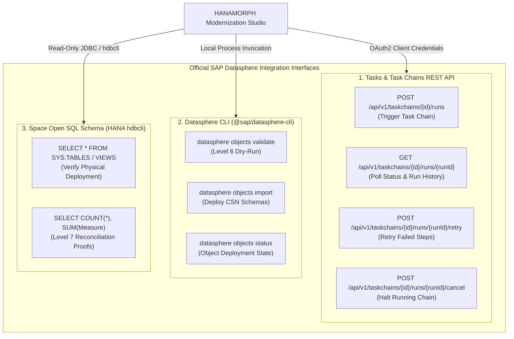
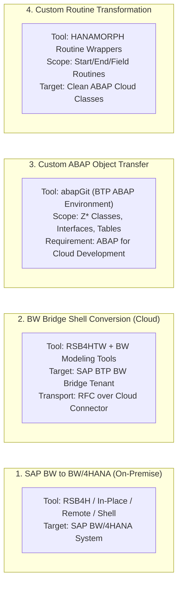
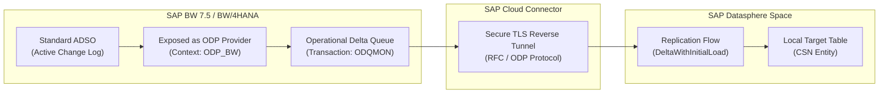

# HANAMORPH BW Migration & Modernization Studio
# Phase 2.1: Evidence Reconciliation & Architecture Review

**Document Reference:** `BW-MIG-REV-2.1`  
**Status:** Completed Reconciled Review  
**Review Target:** Architecture Blueprint 1.0 & Red-Team Review 2.0  
**Lead Reviewer:** Independent SAP Enterprise Architect, BW/4HANA Migration Specialist & Security Auditor  
**Date:** November 21, 2026  

---

## 1. Executive Summary & Review Scope

The Phase 2.0 Red-Team Review identified five major architectural fallacies in **Architecture Blueprint 1.0**. However, several claims in Review 2.0 itself were overly broad or required critical technical nuance:
1. **Datasphere Task API Classification:** Review 2.0 erroneously labeled the Datasphere Task API as "invented". In reality, SAP Datasphere publishes an official **Task API** (Task Chains REST API) on the SAP Business Accelerator Hub, while Replication Flow monitoring is governed through separate Data Integration APIs and the `@sap/datasphere-cli`.
2. **BW Bridge Tooling Precision:** Review 2.0 correctly debunked loose abapGit XML file conversion for ADSOs, but oversimplified the conversion tooling by referencing `RSB4H` alone. The dedicated tooling for SAP Datasphere BW Bridge shell conversion is **`RSB4HTW`** (Transfer to BW Bridge / Cloud) in source BW 7.5 paired with the **BW Bridge Transfer Cockpit** in Eclipse BW Modeling Tools (BWMT).
3. **BDC Data Product Manifests:** Review 2.0 proposed `data-product.json`, but failed to note that SAP Datasphere Data Sharing Cockpit does **not** expose an automated public CLI to import generic JSON files into live data products. This workflow is currently a **`MANUAL_ADMIN_ACTION`** within the SAP UI.
4. **ODP-BW Replication Granularity:** Review 2.0 rightly banned direct database Change Log reading, but did not define the release-specific constraints of ODP providers (e.g., ADSOs with Change Log support delta, whereas CompositeProviders or Staging ADSOs do not).
5. **Graph Algorithm Nuance:** Review 2.0 noted Tarjan's SCC detects cycles, but did not define how to break cycles to allow Kahn's topological sort to complete.

This **Phase 2.1 Evidence Reconciliation** establishes an authoritative, fully cited baseline reconciling Blueprint 1.0, Review 2.0, and official SAP documentation.

---

## 2. Datasphere API Reconciliation: REST vs. CLI vs. Open SQL

Review 2.0 must be corrected regarding the SAP Datasphere API landscape:

### 2.1 Reconciled Capability Breakdown

| Capability Scope | Exact Interface & Method | Official SAP Documentation URL | Authentication & Scopes | Verification Status |
| :--- | :--- | :--- | :--- | :---: |
| **Task Chain Execution & Monitoring** | REST API: `/api/v1/taskchains/{id}/runs` (`POST`, `GET`, `CANCEL`) | [SAP Accelerator Hub: Datasphere Task API](https://api.sap.com/api/DATASPHERE_TASK/overview) | OAuth2 Client Credentials; Scope: `dwaas-core` | **`VERIFIED`** |
| **Replication Flow Management** | REST API & Data Integration Monitor | [SAP Help: Managing Replication Flows](https://help.sap.com/docs/SAP_DATASPHERE/c8a5410afbbf4928ac78477215c0e178/48fb6a52865d4fa397240c9535f2fcb6.html) | OAuth2 Client Credentials; Space-level integration rights | **`VERIFIED_WITH_PREREQUISITES`** |
| **Object Validation & Deployment** | CLI: `datasphere objects validate` / `import` | [npm: @sap/datasphere-cli](https://www.npmjs.com/package/@sap/datasphere-cli) | Passcode or OAuth2 Client Secret | **`VERIFIED`** |
| **Reconciliation Evidence Verification** | Open SQL: `SELECT COUNT(*)`, `SUM(m)` via `hdbcli` | [SAP Help: Open SQL Schema Access](https://help.sap.com/docs/SAP_DATASPHERE/c8a5410afbbf4928ac78477215c0e178/143588efebda4ca0b42f61ee5582f6f4.html) | Space Database User & TLS Credentials | **`VERIFIED`** |

> [!NOTE]
> **Reconciliation Conclusion:** The Tasks API is an **official, standard SAP Datasphere REST API** documented on the SAP Business Accelerator Hub for task chains. However, generic replication flow monitoring must combine this with Data Integration endpoints, `@sap/datasphere-cli`, and target Open SQL database queries.

---

## 3. SAP BW Bridge Conversion Workflow Disambiguation

To eliminate architectural confusion, five related but distinct conversion concepts must be differentiated:

### 3.1 Precise Workflow Specifications

| Dimension | On-Premise BW/4HANA Conversion | SAP Datasphere BW Bridge Shell Conversion | Custom ABAP Package Transfer |
| :--- | :--- | :--- | :--- |
| **Primary Transaction** | `RSB4H` / Program `RS_B4HANA_CONVERSION` | **`RSB4HTW`** (Transfer to BW Bridge / Cloud) | None (Eclipse ADT / abapGit UI) |
| **Modeling Client** | SAP GUI / Eclipse BWMT | **Eclipse BW Modeling Tools (BWMT)** | Eclipse ABAP Development Tools (ADT) |
| **Network Path** | RFC / System-to-System | **RFC over SAP Cloud Connector** | HTTPS / Git Protocol to BTP ABAP |
| **Supported Objects** | ADSO, Open ODS, CP, BEx Queries | **ADSO, InfoObjects, Transformations, DTPs** | ABAP Classes (`CLAS`), Interfaces (`INTF`) |
| **Unsupported Objects** | Classic Cubes, MultiProviders, InfoSets | **Queries (BEx), APDs, Process Chains with OS steps** | Obsolete dynpros, direct OS access |
| **abapGit Role** | Optional code transport | **Zero role for ADSOs** (Custom code sync only) | **Primary Git synchronization client** |

> [!IMPORTANT]
> **Authoritative Correction:** SAP BW Bridge Shell Conversion is initiated via transaction **`RSB4HTW`** in SAP BW 7.5 (enabled via SAP Note 3141688) and managed via Eclipse BW Modeling Tools. Loose abapGit XML files cannot create BW Bridge ADSOs.

---

## 4. BDC Data Product Generator: Reality vs. Assumptions

Review 2.0 correctly banned the private class `CL_RSO_DATA_PRODUCT`, but proposed emitting `data-product.json`. We must clarify the actual execution boundary:

1. **Prerequisites & Tooling:**
   - Supported exclusively on **SAP BW/4HANA 2021 SP04+** or **2023**.
   - Administered via the **SAP BW Cockpit** (Fiori Launchpad app: *Manage Data Subscriptions*) or transaction **`RSDPS`**.
2. **Physical Storage:**
   - Subscriptions publish data to a dedicated **BW File Space** (cloud object storage configured between BW/4HANA and Datasphere).
3. **Publication Contract:**
   - SAP Datasphere exposes published subscriptions through the **Data Sharing Cockpit**.
   - **Crucial Finding:** SAP Datasphere does **not** provide an automated public REST API or CLI command to import arbitrary third-party `data-product.json` files to create live data products.
4. **Classification in HANAMORPH:**
   - Generating `data-product.json` is strictly an **ADVISORY SPECIFICATION / RUNBOOK GENERATION** capability.
   - Live publication is classified as **`MANUAL_ADMIN_ACTION`** within the SAP Datasphere Data Sharing Cockpit.

---

## 5. Operational Data Provisioning (ODP) & Hybrid Replication

Direct database Change Log reading (`/BIC/A*2`) is officially rejected. The supported replication architecture is strictly **ODP-BW**:

### 5.1 Release & Provider Capability Constraints

| Object Type | ODP Context | Full Load Supported? | Delta Load Supported? | Delta Mechanism & Notes |
| :--- | :--- | :---: | :---: | :--- |
| **Standard ADSO (with Change Log)** | `ODP_BW` | **Yes** | **Yes** | Delta generated via Change Log table; managed in `ODQMON`. |
| **Staging ADSO (Inbound Only)** | `ODP_BW` | **Yes** | **No** (Full only) | No Change Log present; delta requires full reload or date-slice filter. |
| **Direct-Write ADSO** | `ODP_BW` | **Yes** | **No** (Full only) | Unbuffered direct writes; delta extraction unsupported. |
| **CompositeProvider (HCPR)** | `ODP_BW` | **Yes** | **No** (Generally Full) | Joins and unions cannot produce Change Log delta records. |
| **SAP SAPI DataSource** | `ODP_SAP` | **Yes** | **Yes** | Delta managed via source extractor delta queue (delta init required). |
| **ABAP CDS Analytical View** | `ODP_CDS` | **Yes** | **Yes** | Requires `@Analytics.dataExtraction.enabled: true` and delta change data capture annotation. |

---

## 6. Authoritative Decision on Blueprint 1.0 vs. Review 2.0 Claims

| Architectural Claim | Blueprint 1.0 Stance | Review 2.0 Stance | Review 2.1 Reconciled Finding |
| :--- | :--- | :--- | :--- |
| **Datasphere Tasks API** | Proposed for monitoring | Labeled as "invented" | **VERIFIED:** Official REST API exists on SAP Accelerator Hub for Task Chains. |
| **BW Bridge Shell Tooling** | abapGit XML generation | Cited `RSB4H` only | **RECONCILED:** Tooling is `RSB4HTW` + Eclipse BWMT; abapGit is for custom code only. |
| **BDC Data Product CLI** | Proposed `CL_RSO_DATA_PRODUCT` | Proposed `data-product.json` | **RECONCILED:** Advisory manifest only; live publish is `MANUAL_ADMIN_ACTION`. |
| **Hybrid Delta Replication** | Direct Change Log table read | Mandated ODP-BW | **AFFIRMED:** ODP-BW with `ODQMON` is the only supported enterprise pattern. |
| **Connection Diagnostics** | `BAPI_USER_GET_DETAIL` | `RFC_PING`, `STFC_CONNECTION` | **AFFIRMED:** Benign RFCs eliminate security risks. |
| **Canonical URN Syntax** | Omitted client/version | Added client, version, escape | **AFFIRMED:** Full tuple prevents namespace and multi-client collisions. |
| **SQLite Concurrency** | Naive direct multi-thread | Single-Writer Ingestion Queue | **AFFIRMED:** Eliminates `SQLITE_BUSY` crashes under batch loads. |
| **Tarjan's SCC Cycles** | Claimed Tarjan resolves | Tarjan detects; need breaker | **AFFIRMED:** Tarjan identifies SCCs; explicit cycle resolution strategies required. |
| **HMAC Key Management** | Confused PBKDF2 with HMAC | Separate PBKDF2 from HMAC | **AFFIRMED:** PBKDF2 for key derivation; HMAC-SHA-256 for audit signing. |
| **Performance Claims** | 50k in 12s claimed verified | Labeled aspirational target | **AFFIRMED:** Classified as `BENCHMARK_TARGET` pending reproducible test harness. |
