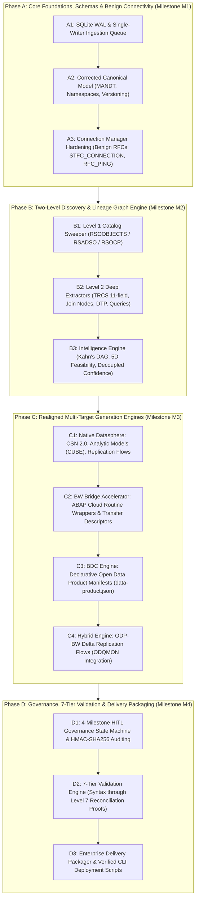

# HANAMORPH BW Migration & Modernization Studio
# Revised Implementation Master Roadmap — Architecture Blueprint 1.0 Review

**Document Reference:** `BW-MIG-REVRD-2.0`  
**Status:** Approved Phased Implementation Plan  
**Target Studio:** `BW_Migration_Studio/bw-studio`  
**Classification:** SAP Enterprise Modernization Engineering Schedule  
**Date:** November 21, 2026  

---

## 1. Engineering Realignment & Sequencing Principles

Following the Phase 2 Red-Team audit, the engineering roadmap is restructured to enforce **Core Correctness and Architectural Validity First**:
1. **Elimination of Premature Cloud Packaging:** Cloud Foundry MTA packaging and XSUAA configuration are deferred until the multi-target generation and validation engines are proven locally.
2. **Strict Adherence to Red-Team Corrections:** All nine architectural corrections (benign RFCs, corrected URNs, ODP-BW hybrid replication, Transfer Cockpit alignment, single-writer SQLite queue, and 4-milestone governance) are embedded directly into Phase A and Phase B work packages.
3. **Preservation Invariant:** All 43 baseline automated tests in `tests/run_all_tests.py` must remain 100% passing across all engineering phases.

---

## 2. Revised 4-Milestone Phased Engineering Schedule

---

## 3. Detailed Work Breakdown & Acceptance Milestones

### Milestone M1 (Phase A): Core Foundations & Benign Connectivity
- **Work Package A.1: Storage Architecture & Queue Engine:**
  - Configure `PRAGMA journal_mode = WAL;` and foreign key enforcement in `db.py`.
  - Implement the **Single-Writer Ingestion Queue** (`queue.Queue`) to decouple worker threads from SQLite transactions, preventing `SQLITE_BUSY` errors.
- **Work Package A.2: Canonical Metadata Model & Corrected URNs:**
  - Implement the corrected canonical URN specification: `urn:sap:bw:<system>:<client>:<type>:<escaped_name>:<version>`.
  - Introduce relational entities for `FieldSemantics` (explicit currency/unit bindings and compounding parents).
- **Work Package A.3: Benign Connectivity & Read-Only Hardening:**
  - Replace `BAPI_USER_GET_DETAIL` with `RFC_PING` and `STFC_CONNECTION`.
  - Enforce the unbypassable HTTP `GET`/`HEAD` verb whitelist for all SAP endpoints.
- **Acceptance Criteria:**
  - 43/43 baseline tests pass without regression.
  - URN generator correctly encodes slashes for namespaced objects (`/COMPANY/SALES_01`).
  - Concurrent batch ingestion of 5,000 entities completes with zero SQLite lock errors.

---

### Milestone M2 (Phase B): Two-Level Discovery & Lineage Graph Engine
- **Work Package B.1: Level 1 Lightweight Catalog Sweeper:**
  - Query official DDIC catalog tables (`RSOOBJECTS`, `RSADSO`, `RSOCP`, `RSTRAN`) to catalog objects across InfoAreas.
  - Implement SHA-256 snapshot hashing to detect new, modified, and decommissioned objects.
- **Work Package B.2: Level 2 Deep Extractors & Virtual Stubs:**
  - Implement specialized extractors for ADSO dimensions, CompositeProvider join trees, TRCS 11-field transformation rules, and DTP modes.
  - Build `VirtualStubEntity` handler for unresolved upstream dependencies ($C_{dep} = 0.40$).
- **Work Package B.3: Intelligence Engine (Kahn's DAG & 5D Scoring):**
  - Implement topological sort with Tarjan's SCC cycle breaking to assign dependency depths.
  - Compute 5D composite feasibility scores ($S_{total}$) and decoupled confidence scores ($C_{total}$).
- **Acceptance Criteria:**
  - Level 1 inventory completes in $<30$ seconds for 50,000 objects over test fixtures.
  - Deep discovery of `ZSAM_SO01` and `ZSAM_SO_CP` extracts complete field schemas, join trees, and currency links.
  - RAM consumption stays strictly bounded ($\text{RSS} \le 512\text{MB}$).

---

### Milestone M3 (Phase C): Realigned Multi-Target Generation Engines
- **Work Package C.1: Native Datasphere Generator (`datasphere.py`):**
  - Generate CSN 2.0 Local Tables and Views with `@Semantics.amount.currencyCode`.
  - Generate Analytic Models (`@Analytics.dataCategory: "CUBE"`) for BW Queries.
  - Emit `.flow.json` Replication Flow specifications targeting ODP extraction.
- **Work Package C.2: BW Bridge Accelerator (`bridge.py`):**
  - Implement BTP ABAP Cloud routine wrappers, transforming legacy routine logic into clean ABAP Cloud classes (`ZCL_TRFN_*`).
  - Generate shell transfer metadata descriptors formatted for the SAP Transfer Cockpit (`RSB4H`).
- **Work Package C.3: BDC Data Product Engine (`bdc.py`):**
  - Generate declarative Open Data Product manifests (`data-product.json`).
  - Document SAP BW Cockpit UI configuration requirements for Data Subscriptions.
- **Work Package C.4: Hybrid Coexistence Coordinator (`hybrid.py`):**
  - Generate ODP-BW replication configurations tapping Operational Delta Queues (`ODQMON`).
  - Generate delta reconciliation monitoring scripts and cutover checklists.
- **Acceptance Criteria:**
  - Generated CSN schemas pass validation against official SAP CDS CSN 2.0 JSON Schemas.
  - abapGit XML confusion eliminated; routine wrappers conform to ABAP for Cloud Development.
  - Hybrid flows specify valid ODP-BW contexts instead of direct table reads.

---

### Milestone M4 (Phase D): Governance, Validation & Delivery Packaging
- **Work Package D.1: Consolidated 4-Milestone Governance (`approval.py`):**
  - Implement the 4-milestone state machine: Scope $\rightarrow$ Architecture $\rightarrow$ Generation $\rightarrow$ Cutover.
  - Implement HMAC-SHA256 tamper-evident signing for all milestone audit entries, with PBKDF2 key derivation and key ID tracking (`kid`).
- **Work Package D.2: 7-Tier Validation Engine (`validation.py`):**
  - Implement Level 1 (Syntax) through Level 5 (CDC mode) in-engine checks.
  - Implement Level 6 (Datasphere CLI dry-run integration).
  - Implement Level 7 (Reconciliation evidence ingestion: row counts, measure sums, and checksums).
- **Work Package D.3: Delivery Packager (`packager.py`):**
  - Package target code, deployment scripts (`deploy_datasphere.sh`, `deploy_hana.sql`), rollback scripts, and runbooks into a versioned, SHA-256 sealed ZIP archive.
- **Acceptance Criteria:**
  - State machine strictly blocks artifact packaging without valid cryptographic sign-offs.
  - Level 1–5 validations pass with zero false positives.
  - Final ZIP bundle downloads cleanly via Tab 8 with complete audit evidence.
