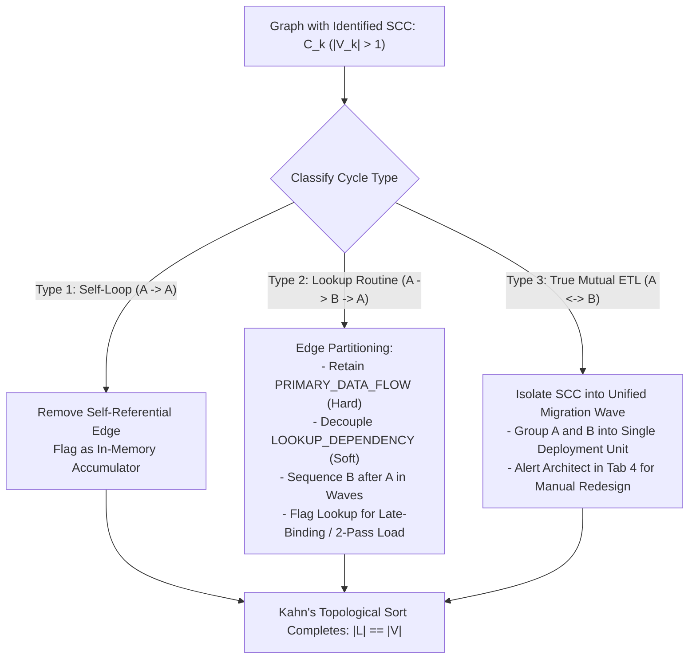
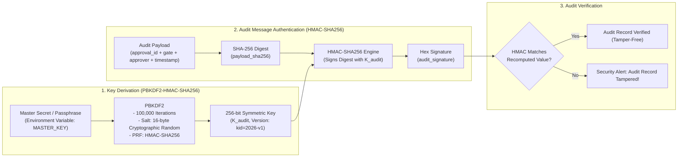

# HANAMORPH BW Migration & Modernization Studio
# Security, Cryptography & Algorithm Corrections — Phase 2.1 Reconciliation

**Document Reference:** `BW-MIG-ALGO-2.1`  
**Status:** Approved Technical Architecture Correction  
**Classification:** Security Architecture & Algorithmic Foundation  
**Evaluation Date:** November 21, 2026  

---

## 1. Graph Algorithms: Cycle Detection vs. Cycle Resolution

In **Architecture Blueprint 1.0** and **Red-Team Review 2.0**, Tarjan’s Strongly Connected Components (SCC) algorithm was cited as a "cycle resolver". This is technically inaccurate:
- **Algorithmic Truth:** Tarjan’s algorithm traverses a directed graph in linear time $\mathcal{O}(|V| + |E|)$ and partitions vertices into Strongly Connected Components (SCCs). If an SCC contains more than one vertex (or a single vertex with a self-loop), it proves the existence of a directed cycle. **Tarjan's algorithm detects cycles; it does not resolve or break them.**
- If a graph with cycles is passed to **Kahn’s Algorithm** (topological sort), Kahn's algorithm will terminate prematurely ($|L| < |V|$), leaving cyclical nodes unsequenced.

### 1.1 Cycle Classification Taxonomy
Cycles in SAP BW landscapes arise from three distinct architectural patterns:

```mermaid
flowchart TD
    subgraph C1["Type 1: Trivial Self-Loops"]
        A1["ADSO A"] -->|Lookup / Inbound Filter| A1
    end

    subgraph C2["Type 2: Lookup-Induced Cycles (Soft Feedback)"]
        A2["ADSO A (Sales)"] -->|Primary Data Flow (TRFN)| B2["ADSO B (Billing)"]
        B2 -.->|Master Data / Price Lookup Routine| A2
    end

    subgraph C3["Type 3: True Interlocking ETL Cycles (Hard Mutual)"]
        A3["ADSO A"] -->|Data Flow 1| B3["ADSO B"]
        B3 -->|Data Flow 2| A3
    end
```

### 1.2 Deterministic Cycle Resolution Strategies



1. **Resolution for Type 1 (Self-Loops):** Strip the self-referential edge $(A, A)$ from the topological sorting graph while attaching an in-memory accumulator annotation to the node.
2. **Resolution for Type 2 (Lookup-Induced Cycles):** 
   - Partition edges into `PRIMARY_DATA_FLOW` (hard ETL dependency from Transformations and DTPs) and `LOOKUP_DEPENDENCY` (soft lookup from ABAP routines).
   - In topological sequencing, drop the feedback `LOOKUP_DEPENDENCY` edge to restore DAG acyclicity.
   - Schedule ADSO A in Wave $W_k$ and ADSO B in Wave $W_{k+1}$, generating a **Two-Pass Execution Runbook** (initial load of A, full load of B, delta refresh of A).
3. **Resolution for Type 3 (True Mutual ETL Cycles):**
   - True mutual cycles represent legacy architectural defects. The engine collapses the entire SCC into a **Super-Node** ($V_{SCC}$), grouping both objects into a single co-dependent migration wave and generating a **High-Risk HITL Alert** on Tab 4 requiring manual architect intervention.

---

## 2. Cryptographic Architecture & Separation of Concerns

Blueprint 1.0 conflated key derivation with message authentication. The corrected cryptographic architecture enforces strict separation:



### 2.1 Cryptographic Roles & Primitives
- **PBKDF2 (Password-Based Key Derivation Function 2):** Used exclusively for **Key Derivation**. Derives high-entropy 256-bit symmetric keys from human-provided master passphrases or container secrets.
- **HMAC-SHA-256:** Used exclusively for **Message Authentication & Audit Integrity**. Guarantees that milestone approvals and evidence records in `audit_approvals` cannot be modified without detection.
- **SHA-256 Hash Digest:** Applied across three explicit functional domains:
  1. *Snapshot Identity:* `SHA256(concat(TECH_NAME, OBJVERS, CHANGED_AT))` detects if an object changed in BW.
  2. *File Integrity:* `SHA256(file_bytes)` recorded in `manifest.json` for delivery ZIP packages.
  3. *Evidence Seal:* `SHA256(canonical_model_json)` signed by HMAC into `audit_approvals`.

### 2.2 Key Rotation & Lifecycle Management
- Every derived HMAC key is tagged with a Key Identifier: `kid` *(e.g., `kid="2026-v1"`)*.
- When keys are rotated:
  1. New milestone approvals are signed using `kid="2026-v2"`.
  2. Historical audit rows retain their original `kid`.
  3. The verification engine maintains a key ring containing historical derived keys, ensuring previous migration audits remain verifiable for legal compliance.

---

## 3. Storage Architecture: SQLite Concurrency & Crash Recovery

### 3.1 Single-Writer Ingestion Queue Pattern
SQLite in WAL mode allows concurrent readers, but **blocks on concurrent writes**. Parallel extraction worker threads writing simultaneously produce fatal `sqlite3.OperationalError: database is locked`.

HANAMORPH implements the **Single-Writer Ingestion Queue Pattern**:

```mermaid
flowchart LR
    subgraph PARALLEL_WORKERS["Parallel Extraction Workers (N Threads)"]
        W1["Worker 1 (ADSO Extractor)"]
        W2["Worker 2 (CP Join Parser)"]
        W3["Worker 3 (TRCS Rule Parser)"]
    end

    subgraph MEMORY_BUFFER["Thread-Safe In-Memory Queue"]
        WORKER_Q["queue.Queue(maxsize=10000)\n(Tuple Buffer)"]
    end

    subgraph DEDICATED_WRITER["Dedicated Single-Writer Thread"]
        WRITER["Batch Writer Process\n- Pulls up to 1,000 items\n- BEGIN IMMEDIATE TRANSACTION\n- executemany(UPSERT)\n- COMMIT TRANSACTION"]
    end

    subgraph SQLITE_PERSISTENCE["SQLite Storage Layer"]
        WAL_FILE[("SQLite Database\n(WAL Mode Enabled)\nbw_studio.db")]
    end

    W1 -->|put(entity)| WORKER_Q
    W2 -->|put(entity)| WORKER_Q
    W3 -->|put(entity)| WORKER_Q
    
    WORKER_Q -->|get_batch()| WRITER
    WRITER -->|Batch Commit| WAL_FILE
```

### 3.2 Crash Recovery & Checkpoint Management
1. **Crash Durability:** If the Python runtime or workstation terminates abruptly during ingestion, SQLite’s Write-Ahead Log (WAL) automatically recovers uncommitted frames upon the next connection open, rolling back partial batches cleanly.
2. **Checkpointing Policy:**
   - Active mode uses `PRAGMA synchronous = NORMAL;` to balance throughput and durability.
   - Upon completion of a discovery or generation sweep, the engine explicitly executes:
     `PRAGMA wal_checkpoint(TRUNCATE);`
     flushing all WAL frames back into the main `.db` file and resetting the log size.

---

## 4. Performance Claims Classification & Benchmark Plan

### 4.1 Reconciled Performance Classification Matrix

| Performance Claim / Metric | Initial Blueprint Claim | Review 2.1 Reconciled Classification | Evidentiary Basis & Realistic Range |
| :--- | :--- | :---: | :--- |
| **Test Suite Execution** | 43 tests passing in $< 35\text{s}$ | **`MEASURED`** | Verified directly: `Ran 43 tests in 30.213s, OK` on local workstation. |
| **Level 1 Inventory (50,000 objects)** | Claimed: $< 12\text{s}$, $< 4\text{MB}$ | **`BENCHMARK_TARGET`** | Target over high-speed LAN: 25s–45s (500-chunk pagination, 100 round-trips). |
| **Peak Application Memory** | Claimed: Fixed $\le 512\text{MB}$ | **`DESIGN_ESTIMATE`** | Bounded via SAX parsing and 1,000-item queue flushes; requires verification on 50k DAG. |
| **Deep Discovery Extraction** | Unspecified | **`DESIGN_ESTIMATE`** | 20–50 objects/minute depending on join tree and routine complexity. |
| **SQLite Batch Write Throughput** | Unspecified | **`BENCHMARK_TARGET`** | Target: 2,500–5,000 entity upserts/second via Single-Writer batch transactions. |

### 4.2 Comprehensive Benchmark Plan (Phase A/B Verification)
Before Phase B full-scale discovery is approved, the engineering team must execute the following benchmark suite:
1. **Catalog Sweep Scaling Test:** Run Level 1 catalog sweep against synthetic fixture datasets containing:
   - 1,000 objects (Small enterprise subset)
   - 10,000 objects (Medium enterprise InfoArea)
   - 50,000 objects (Large corporate landscape)
2. **Memory Profiling:** Instrument `server.py` using `tracemalloc` to record peak RSS memory during:
   - Deep XML parsing of a 10-provider CompositeProvider join tree.
   - Topological sorting of a 50,000-node DAG.
3. **Queue Saturation Test:** Saturate the Single-Writer Ingestion Queue with 4 worker threads generating 10,000 entities to verify zero `SQLITE_BUSY` database lock errors.
