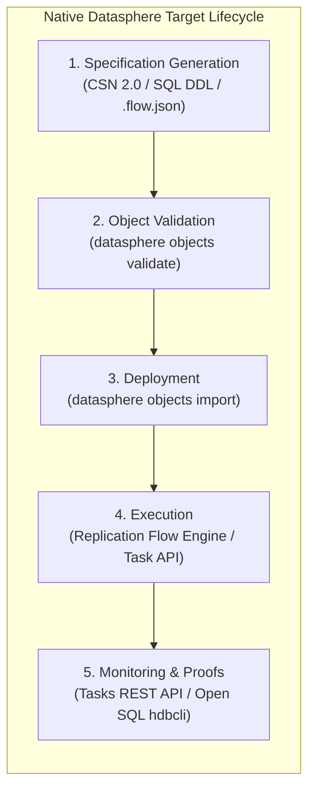
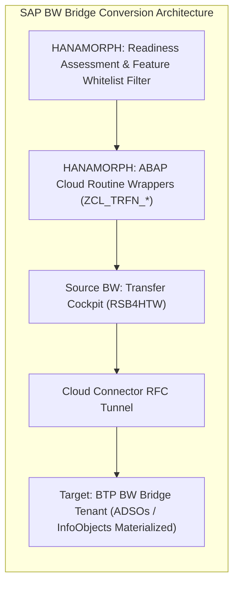

# HANAMORPH BW Migration & Modernization Studio
# Target Route Capability & Maturity Matrix — Phase 2.1 Reconciliation

**Document Reference:** `BW-MIG-TARG-2.1`  
**Status:** Approved Target Strategy Architecture  
**Classification:** SAP Enterprise Modernization Capability Matrix  
**Evaluation Date:** November 21, 2026  

---

## 1. Target Strategy Classification Taxonomy

Every target modernization capability is evaluated against verified SAP capabilities and classified across five lifecycle stages:
1. **Specification Generation:** Can HANAMORPH generate the target code locally?
2. **Object Creation:** How is the target object materialized on SAP infrastructure?
3. **Deployment:** What tool or API deploys the model?
4. **Execution:** What runtime executes data replication or processing?
5. **Monitoring:** How is operational status and data reconciliation proven?

---

## 2. Route 1: Native SAP Datasphere Capability Matrix

| Component / Artifact | Lifecycle Stage | Official Interface / Endpoint | Official SAP Reference URL | Status | Implementation Readiness & Constraints |
| :--- | :--- | :--- | :--- | :---: | :--- |
| **CSN 2.0 Local Table** | Specification | JSON (`type: "entity"`) | [SAP Help: CSN Entities](https://help.sap.com/docs/SAP_DATASPHERE/c8a5410afbbf4928ac78477215c0e178/e6b22c8cb93845dc8a113ecaa68a62f5.html) | **`VERIFIED`** | **READY (In-Engine):** Generates Local Tables with explicit primary keys and `@Semantics.amount.currencyCode`. |
| **CSN Graphical / SQL View** | Specification | JSON (`type: "view"`) | [SAP Help: CSN Views](https://help.sap.com/docs/SAP_DATASPHERE/c8a5410afbbf4928ac78477215c0e178/e6b22c8cb93845dc8a113ecaa68a62f5.html) | **`VERIFIED`** | **READY (In-Engine):** Translates CompositeProvider join trees into projection/join views. |
| **Analytic Model** | Specification | JSON View (`@Analytics.dataCategory: "CUBE"`) | [SAP Help: Analytic Models](https://help.sap.com/docs/SAP_DATASPHERE/c8a5410afbbf4928ac78477215c0e178/143588efebda4ca0b42f61ee5582f6f4.html) | **`VERIFIED`** | **READY (In-Engine):** Maps BW BEx Queries into star-schema analytical cubes with measures and dimensions. |
| **HANA Cloud Column Table DDL** | Specification | SQL (`CREATE COLUMN TABLE`) | [SAP Help: HANA Cloud SQL](https://help.sap.com/docs/HANA_CLOUD/4cd2e2e4b4234b1790e3615437a94f6c/20a6723275191014902187eb190b2b5a.html) | **`VERIFIED`** | **READY (In-Engine):** Emits DDL for open SQL schemas and HDI container persistence. |
| **Replication Flow JSON** | Specification | JSON (`.flow.json`) | [SAP Help: Replication Flows](https://help.sap.com/docs/SAP_DATASPHERE/c8a5410afbbf4928ac78477215c0e178/48fb6a52865d4fa397240c9535f2fcb6.html) | **`VERIFIED_WITH_PREREQUISITES`** | **READY (In-Engine):** Configures source connection, ODP provider, and delta load mode (`DeltaWithInitialLoad`). |
| **Object Dry-Run Validation** | Deployment | CLI: `datasphere objects validate` | [npm: @sap/datasphere-cli](https://www.npmjs.com/package/@sap/datasphere-cli) | **`VERIFIED`** | **READY (Local Subprocess):** Executes Level 6 dry-run against target space without data mutation. |
| **Object Deployment** | Deployment | CLI: `datasphere objects import` | [npm: @sap/datasphere-cli](https://www.npmjs.com/package/@sap/datasphere-cli) | **`VERIFIED`** | **READY (Local Subprocess):** Pushes CSN entities into Datasphere space via OAuth2 credentials. |
| **Task Chain Execution** | Execution | REST: `POST /api/v1/taskchains/{id}/runs` | [SAP Accelerator Hub: Task API](https://api.sap.com/api/DATASPHERE_TASK/overview) | **`VERIFIED`** | **READY:** Triggers execution of sequential task chains via standard REST API. |
| **Task Execution Monitoring** | Monitoring | REST: `GET /api/v1/taskchains/{id}/runs/{runId}` | [SAP Accelerator Hub: Task API](https://api.sap.com/api/DATASPHERE_TASK/overview) | **`VERIFIED`** | **READY:** Polls run history, logs, and task step status via standard REST API. |
| **Physical Schema & Parity Proofs** | Monitoring | Open SQL: `SELECT COUNT(*)`, `SUM(m)` | [SAP Help: Open SQL Schema](https://help.sap.com/docs/SAP_DATASPHERE/c8a5410afbbf4928ac78477215c0e178/143588efebda4ca0b42f61ee5582f6f4.html) | **`VERIFIED`** | **READY (Read-Only):** Ingests Level 7 reconciliation proofs directly from database catalogs. |

---

## 3. Route 2: SAP BW Bridge Capability Matrix

| Component / Task | Lifecycle Stage | Tooling & Interfaces | Official SAP Reference URL | Status | Architectural Role & Boundaries |
| :--- | :--- | :--- | :--- | :---: | :--- |
| **Readiness & Whitelist Assessment** | Assessment | HANAMORPH Assessment Engine | [SAP Help: Supported BW Bridge Objects](https://help.sap.com/docs/SAP_BW_BRIDGE/0eec0d68141541d1b07893a39944924e/e6fd7e3e46e84d4da58df4c8a2455e92.html) | **`VERIFIED`** | **READY (In-Engine):** Identifies incompatible objects (Classic Cubes, MultiProviders, APDs) and flags remodeling actions. |
| **ABAP Cloud Routine Wrapping** | Specification | HANAMORPH Bridge Generator | [SAP Help: ABAP Cloud Model](https://help.sap.com/docs/BTP/65de2977205c403bbc107264b8eccf4b/f746eb988e0b4924b10b064c1bfa7075.html) | **`VERIFIED_WITH_PREREQUISITES`** | **READY (In-Engine):** Transforms legacy routine logic into clean ABAP Cloud classes (`ABAP for Cloud Development`). |
| **Shell Conversion Execution** | Conversion | **`RSB4HTW`** + Eclipse BWMT | [SAP Note 3141688](https://me.sap.com/notes/3141688) | **`MANUAL_ADMIN_ACTION`** | **EXTERNAL SAP TOOL:** Official shell transfer of ADSOs, InfoObjects, and TRFNs into BW Bridge tenant. |
| **Custom Code Transport** | Deployment | abapGit for BTP ABAP | [SAP Help: abapGit on BTP](https://help.sap.com/docs/BTP/65de2977205c403bbc107264b8eccf4b/1bcf9be53bb44fa7848f325d7efc4e33.html) | **`VERIFIED_WITH_PREREQUISITES`** | **EXTERNAL GIT SYNC:** Used solely for syncing custom classes (`ZCL_*`) into customer BTP software components. |
| **Direct ADSO XML Import** | Deployment | abapGit XML file import | None | **`NOT_SUPPORTED`** | **REJECTED:** SAP BW Bridge does not support creating ADSOs via loose abapGit XML files. |

---

## 4. Route 3: SAP Business Data Cloud (BDC) Capability Matrix

| Component / Task | Lifecycle Stage | Tooling & Interfaces | Official SAP Reference URL | Status | Architectural Role & Boundaries |
| :--- | :--- | :--- | :--- | :---: | :--- |
| **Data Product Manifest Generation** | Specification | HANAMORPH BDC Generator | [SAP Help: Data Products](https://help.sap.com/docs/SAP_DATASPHERE/c8a5410afbbf4928ac78477215c0e178/3f7bf92e624b4df9977e0cebc06cb5eb.html) | **`VERIFIED`** | **READY (In-Engine / Advisory):** Emits declarative `data-product.json` capturing domains, terms, schemas, and SLAs. |
| **BW Data Subscription Configuration** | Creation | **SAP BW Cockpit** / **`RSDPS`** | [SAP Help: Data Subscriptions](https://help.sap.com/docs/SAP_BW4HANA/ed919380760a44388ab90e6bb3e7480a/4b5a3e145f8e4e7e8b6b23f2f7e7e6a1.html) | **`MANUAL_ADMIN_ACTION`** | **EXTERNAL BW/4HANA TOOL:** Configured via Fiori app on BW/4HANA 2021 SP04+ or 2023. |
| **Physical Data Product Publishing** | Publication | **Data Sharing Cockpit (UI)** | [SAP Help: Data Sharing Cockpit](https://help.sap.com/docs/SAP_DATASPHERE/c8a5410afbbf4928ac78477215c0e178/e6b22c8cb93845dc8a113ecaa68a62f5.html) | **`MANUAL_ADMIN_ACTION`** | **EXTERNAL DATASPHERE UI:** Governs enterprise consumer contracts and marketplace publication. |
| **Automated Data Product CLI Import** | Deployment | N/A (No public CLI exists) | None | **`NOT_SUPPORTED`** | **NO PUBLIC CLI:** Datasphere does not offer a CLI to instantiate live data products from JSON files. |
| **Internal Class Calling (`CL_RSO_DATA_PRODUCT`)** | Execution | ABAP Internal Kernel Class | None | **`NOT_SUPPORTED`** | **REJECTED:** Private SAP kernel class prohibited for external tooling invocation. |

---

## 5. Route 4: Hybrid Modernization & Coexistence Matrix

| Capability / Flow | Operational Owner | Synchronization Mechanism | Delta Consistency Model | Failure & Conflict Recovery | Official SAP Source | Status |
| :--- | :--- | :--- | :--- | :--- | :--- | :---: |
| **ADSO to Datasphere ODP Replication** | Source SAP BW + Datasphere Flow | ODP Context (`ODP_BW`) over Cloud Connector | Delta managed in `ODQMON` (Change Log after-image extraction) | Re-read delta queue; reset pointer in `ODQMON` upon data corruption. | [SAP Note 2481335](https://me.sap.com/notes/2481335) | **`VERIFIED`** |
| **Direct DB Change Log Reading** | N/A | SQL query on `/BIC/A*2` | **None** (Bypasses SAP application delta logic) | **Hazardous:** High risk of double counting or unhandled delete images. | None | **`NOT_SUPPORTED`** |
| **Dual-Run Reporting & Cutover** | Enterprise BI Team | Dual extraction to SAC (Source BW vs. Datasphere View) | Reconciliation gate verifies variance $< 0.001\%$ before cutover sign-off | Revert SAC dashboard data source pointer to legacy BW if target fails. | [SAP Help: Dual Run](https://help.sap.com/docs/SAP_DATASPHERE) | **`VERIFIED`** |
