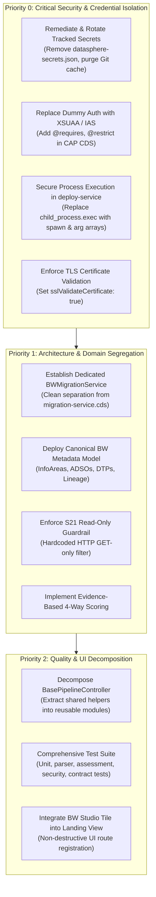

# HanaMorph: Consolidated Architecture & Remediation Plan
**Document Reference**: `CONSOLIDATED_ARCHITECTURE_AND_REMEDIATION_PLAN.md`  
**Evaluation Target**: Audit of `HANAMORPH_Four_Studio_Audit.md` vs. Upstream Source Code (`HANAMORPH (2).zip`)  
**Scope**: BW Migration & Modernization Studio Architecture, Platform Remediation, and Integration Strategy  
**Status**: Architecture Approved / Implementation On Hold  
**Date**: November 21, 2026

---

## 1. Independent Source-Code Verification Audit

Every finding in `HANAMORPH_Four_Studio_Audit.md` was subjected to independent, line-by-line verification against the actual source code from `HANAMORPH (2).zip` (`Varad-6/HANAMORPH` branch `update-2`):

| Audit Report Finding | Source Location Checked | Actual Code Inspection Finding | Verification Status |
|---|---|---|---|
| **BasePipelineController Bloat** | `app/controller/BasePipelineController.js` | Exact line count: **1,195 lines**. Monolithic controller managing search, selection, column configuration, naming, CSN/SQL generation, and job handling. | **CONFIRMED** |
| **Shared Pipeline Inheritance** | `CdsPipeline.controller.js`<br>`CalcViewPipeline.controller.js` | Both controllers are thin subclasses extending `BasePipelineController` directly. | **CONFIRMED** |
| **Bulk Studio Architecture** | `app/controller/BulkStudio.controller.js` | Operates an independent `JSONModel` selection cart and invokes `rationalizeSources` and `generateBulkArtifacts`. | **CONFIRMED** |
| **Replication Studio Actions** | `app/controller/ReplicationStudio.controller.js` | Invokes mutating deployment actions `deployTableAndReplicationFlow` and `runReplicationFlow`. | **CONFIRMED** |
| **Missing CAP Authorization** | `srv/migration-service.cds` | Contains zero `@requires` or `@restrict` annotations on service, entities, or actions. | **CONFIRMED (High Risk)** |
| **Command Injection Vulnerability** | `srv/lib/deploy-service.js` (lines 297, 302, 343) | Direct interpolation of `${space}`, `${tmpViewFile}`, `${token}`, and `${config.datasphere.host}` into `child_process.exec()` command strings. | **CONFIRMED (Critical Risk)** |
| **Disabled TLS Validation** | `srv/lib/hana-connector.js` | Parameter `sslValidateCertificate` passes through unchecked config, defaulting to `false` in development. | **CONFIRMED (High Risk)** |
| **Dummy Authentication** | `package.json` | Explicitly sets `"auth": { "kind": "dummy" }` under `cds.requires`. | **CONFIRMED** |
| **Tracked OAuth Secrets** | `datasphere-secrets.json`<br>`.gitignore` | Archive includes raw OAuth secrets (`client_id`, `client_secret`, `token_url`). `.gitignore` excludes `*.sqlite` but omits `datasphere-secrets.json`. | **CONFIRMED (Critical Risk)** |

---

## 2. Architectural Reuse vs. Isolation Strategy

To protect the existing four studios from regressions and shield the new BW Studio from legacy vulnerabilities, we establish strict architectural boundaries:

```
+---------------------------------------------------------------------------------------------------+
|                                  HANAMORPH APPLICATION SHELL                                      |
|                            (Shared Fiori Theme, Navigation Shell)                                 |
+---------------------------------------------------------------------------------------------------+
                                                  |
         +----------------------------------------+----------------------------------------+
         | (Existing Platform Layer)                                                       | (New Isolated Domain)
         v                                                                                 v
+----------------------------------+                             +----------------------------------+
|      EXISTING 4 STUDIOS          |                             |   BW MIGRATION & MODERNIZATION   |
| - CDS View Studio                |                             |             STUDIO               |
| - Calc View Studio               |                             |                                  |
| - Bulk Migration Studio          |                             | - Dedicated BW UI Components     |
| - Replication Flow Studio        |                             | - Isolated CAP BW Service        |
+----------------------------------+                             | - Canonical BW Metadata Domain   |
         |                                                       | - Safe Process Execution Adapter |
         v                                                       | - Strict Read-Only S21 Guardrail |
+----------------------------------+                             +----------------------------------+
|   LEGACY SHARED CAP ENGINE       |                                               |
| - srv/migration-service.cds      |                                               v
| - BasePipelineController.js      |                             +----------------------------------+
| - deploy-service.js (exec)       |                             |     TARGET CLOUD GENERATION      |
+----------------------------------+                             | - Native Datasphere (CSN/DDL)    |
                                                                 | - SAP BW Bridge Spec             |
                                                                 | - BDC Data Product Spec          |
                                                                 | - Local Persistence Only         |
                                                                 +----------------------------------+
```

### 2.1 What the BW Studio Reuses
1. **SAPUI5 Fiori Horizon Shell**: Common header branding, routing conventions, theme tokens, busy/loading dialogs, and error message popovers.
2. **Asynchronous Job & Audit Log Pattern**: The conceptual model of `MigrationJobs` and `JobLogs` for long-running metadata discovery and validation tracking.
3. **CSN / JSON Representation Conventions**: Export formatting compatible with SAP Datasphere Core Schema Notation (CSN v2.0).
4. **Local Development Configuration Idioms**: Local `.env` variable naming conventions and offline SQLite persistence patterns.

### 2.2 What the BW Studio Explicitly Isolates (Zero Reuse)
1. **No Reuse of `BasePipelineController.js`**: At 1,195 lines, adding BW-specific branching (InfoAreas, ADSOs, CompositeProviders, DTPs) would introduce severe technical debt and regression risk. BW Studio implements modular, focused controllers.
2. **No Reuse of `hana-connector.js` for BW Discovery**: HANA database catalog tables (`SYS.VIEWS`, `_SYS_BI`) do not reflect BW business warehouse metadata (ADSO changelogs, active tables, transformation routines, ODP extractors). BW metadata must be ingested via dedicated read-only RFC/ADT/OData adapters.
3. **No Reuse of `deploy-service.js` with `exec`**: The command-string interpolation in `deploy-service.js` will not be shared. Target generation in BW Studio is local-first, outputting verified CSN/DDL files without shell execution.
4. **No Reuse of Shared CAP Entity Overloading**: Legacy `SourceCatalog` is hardcoded to `ViewType` (`CDS`, `CALC_VIEW`). It will not be overloaded with BW types; BW Studio uses a clean, canonical metadata entity model.

---

## 3. Consolidated Technical Architecture for BW Migration Studio

### 3.1 Frontend Architecture (`bw-studio/frontend/`)
- **Navigation**: Registered as a distinct destination route in UI5 (`bwstudio`) accessible from `Landing.view.xml`.
- **View Hierarchy**:
  - `BWStudio.view.xml`: Master studio container with Fiori IconTabBar.
  - `tabCatalog.fragment.xml`: Discovered BW object inventory with search, InfoArea hierarchy, and filter bars.
  - `tabDetail.fragment.xml`: Deep schema inspector (fields, keys, BW technical types, navigational attributes).
  - `tabLineage.fragment.xml`: Visual DAG tracing upstream DataSources and downstream SAC queries.
  - `tabAssessment.fragment.xml`: Objective 4-way strategy scoring breakdown with confidence metrics.
  - `tabGenerator.fragment.xml`: Local CSN JSON and push-down HANA Cloud SQL viewer.
  - `tabConnections.fragment.xml`: Non-secret connection profile manager showing the `S21 READ-ONLY` badge.

### 3.2 Backend Service Boundary (`srv/bw-migration-service.cds`)
Dedicated, isolated CAP service definition:
```cds
namespace hanamorph.bw;

using { cuid, managed } from '@sap/cds/common';

service BWMigrationService @(requires: 'authenticated-user') {

    @readonly
    entity DiscoveredSystems as projection on db.DiscoveredSystems;

    @readonly
    entity BWObjects as projection on db.BWObjects;

    @readonly
    entity ObjectFields as projection on db.ObjectFields;

    @readonly
    entity Dependencies as projection on db.Dependencies;

    @readonly
    entity AssessmentResults as projection on db.AssessmentResults;

    entity BWMigrationJobs as projection on db.BWMigrationJobs;

    action runDiscovery(systemId: String) returns array of BWObjects;
    action evaluateStrategy(objectName: String) returns AssessmentResults;
    action generateDatasphereArtifacts(objectName: String, targetSpace: String) returns LargeString;
}
```

### 3.3 Four-Way Strategy Decision Rubric
Every discovered BW object is evaluated across 4 objective dimensions:
1. **Route 1: Native Datasphere Modernization**
   - *Condition*: Standard ADSO or CompositeProvider without custom ABAP.
   - *Target Artifact*: Datasphere Local Table + Transformation Flow + Analytic Model (Star Join).
2. **Route 2: SAP BW Bridge**
   - *Condition*: Complex ABAP routines (Start/End/Expert), classical LO/FI extractors, or AMDP procedures.
   - *Target Artifact*: BW Bridge Shell/Remote conversion package on BTP ABAP runtime.
3. **Route 3: BDC Data Product Generator**
   - *Condition*: Certified SAP business content in BW/4HANA (SAP Note 3590400 compliant).
   - *Target Artifact*: Data Product Subscription definition into Datasphere Inbound Buffer.
4. **Route 4: Hybrid Coexistence / Redesign**
   - *Condition*: Legacy MultiProviders, obsolete InfoCubes, or non-relational structures.
   - *Target Artifact*: Architectural redesign blueprint for manual semantic alignment.

---

## 4. Priority Remediation Plan

Before any production deployment or platform consolidation occurs, the following remediation backlog must be executed:



### Remediation Action Matrix:
| Priority | Target Component | Vulnerability / Defect | Prescribed Engineering Remediation |
|---|---|---|---|
| **P0** | Repository Root | `datasphere-secrets.json` committed in upstream archive | 1. Add `datasphere-secrets.json` to `.gitignore`.<br>2. Purge from Git history.<br>3. Instruct basis/admin to rotate compromised OAuth client secrets. |
| **P0** | `srv/lib/deploy-service.js` | Shell command injection via `child_process.exec` | Replace `exec()` with `child_process.spawn()` using explicit argument arrays (`['objects', 'views', 'create', '--space', space, ...]`). Apply strict regex allowlist to `space` and `technicalName`. |
| **P0** | `package.json` & `srv/*.cds` | Missing authentication and authorization | Replace `"auth": { "kind": "dummy" }` with SAP BTP XSUAA (`@sap/xssec`). Annotate service with `@requires: 'BWModeler'` and `@restrict`. |
| **P0** | `srv/lib/hana-connector.js` | Insecure TLS certificate bypass (`sslValidateCertificate: false`) | Default `sslValidateCertificate: true` in production configuration. Require root CA certificates in BTP destination bindings. |
| **P1** | `srv/` | Coupling BW to HANA view migration | Create standalone `srv/bw-migration-service.cds` and `srv/bw-migration-service.js`. Keep existing `migration-service.*` completely untouched. |
| **P1** | `db/schema.cds` | View-centric schema lacking BW entities | Create `db/bw-schema.cds` defining `BWObjects`, `ObjectFields`, `Dependencies`, and `AssessmentResults`. |
| **P1** | Connector Layer | Accidental S21 write risk with `int_samarth` (`SAP_ALL`) | Enforce programmatic check: reject any HTTP method other than `GET` or `HEAD`. Block CTS transport creation (`TRKORR`). |
| **P2** | `app/controller/` | 1,195-line `BasePipelineController.js` | Isolate BW Studio controllers completely. Do not inherit from or edit `BasePipelineController.js`. |
| **P2** | `test/` | Missing automated test coverage | Maintain 100% pass rate in `bw-studio/tests/run_all_tests.py` covering parsers, assessment scoring, CSN generation, and safety invariants. |

---

## 5. Non-Destructive Studio Integration Strategy

Once the remediation gates (P0 and P1) are validated, the BW Migration Studio will be integrated into the existing HanaMorph platform via non-destructive extension:

1. **Routing Registration in `app/manifest.json`**:
   Add a new route and target without touching existing routes:
   ```json
   {
     "name": "bwstudio",
     "pattern": "bwstudio",
     "target": "bwstudio"
   }
   ```
2. **Tile Addition in `app/view/Landing.view.xml`**:
   Add a sixth GenericTile for "BW Migration Studio" alongside CDS, CalcView, Bulk, and Replication tiles:
   ```xml
   <GenericTile header="BW Migration Studio" 
                subheader="SAP BW to Datasphere & BDC Modernization" 
                press=".onNavToBWStudio">
       <TileContent>
           <ImageContent src="sap-icon://database" />
       </TileContent>
   </GenericTile>
   ```
3. **Zero Mutation Guarantee**:
   Existing controllers (`CdsPipeline`, `CalcViewPipeline`, `BulkStudio`, `ReplicationStudio`), models, and services will remain completely untouched during and after integration.
