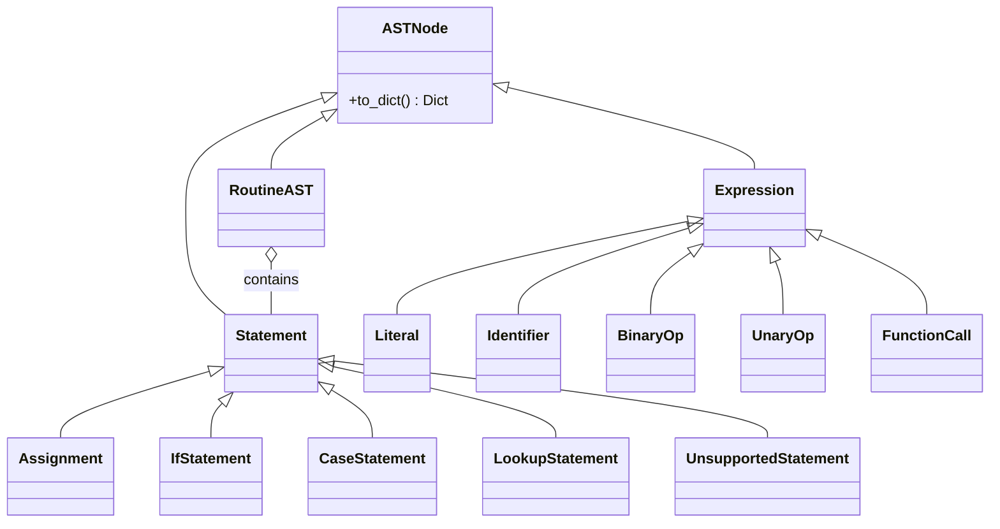
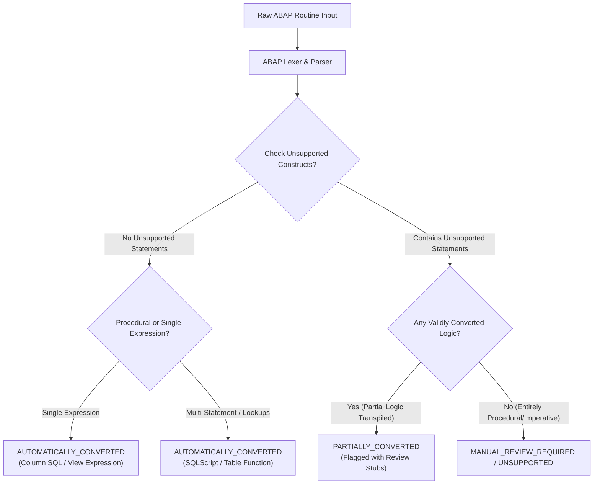

# HANAMORPH BW Migration & Modernization Studio
# M4.2 ABAP Transformation & Modernization Engine Specification

**Document Version:** 1.0.0  
**Milestone:** M4.2 (Transformation and Target Generation Intelligence)  
**Status:** APPROVED  
**Date:** 2026-11-22  
**Target Systems:** SAP HANA Cloud, SAP Datasphere, SAP BW/4HANA, SAP Analytics Cloud (SAC)

---

## 1. Executive Summary & Architectural Motivation

Legacy SAP BW systems (SAP NetWeaver BW 7.3 – 7.53) rely heavily on procedural ABAP routines embedded within Transformation rules (RSTRAN):
- **Start Routines**: Executed prior to transformation mapping, operating across entire data packages (`SOURCE_PACKAGE`).
- **End Routines**: Executed post-mapping on `RESULT_PACKAGE`.
- **Field Routines**: Computed per record for a specific target InfoObject (`RESULT = ...`).
- **Expert Routines**: Complete custom procedural pipelines bypassing standard rule mappings.

Naive migration utilities typically attempt regex pattern replacement or hallucinate SQL snippets, leading to silent calculation errors, unbounded memory consumption, and runtime crashes in cloud environments.

HANAMORPH M4.2 introduces an **AST-Driven Transpilation Engine**:
1. **Lexical Analysis & Syntax Parsing**: Tokenizes ABAP code into a strict typed Abstract Syntax Tree (`abap_ast.py`, `abap_parser.py`).
2. **Intermediate AST Representation**: Declaratively models statements, expressions, control flow (`IfStatement`, `CaseStatement`), function calls, and lookups (`LookupStatement`).
3. **Target Dialect Code Generation**: An AST visitor generates optimized SAP HANA SQL or SAP Datasphere calculated column expressions (`sql_translator.py`).
4. **Honest Architectural Classification**: Whenever an ABAP construct cannot be declaratively expressed in SQL without semantic loss, the engine yields an explicit `UnsupportedStatement` accompanied by precise line numbers, architectural reasons, and remediation guidance.

---

## 2. AST Grammar & Node Hierarchy

### Supported ABAP Grammar Subset

| ABAP Syntax | AST Representation | Target SQL Mapping |
| :--- | :--- | :--- |
| `RESULT = SOURCE_FIELDS-NETWR.` | `Assignment(Identifier('RESULT'), Identifier('NETWR'))` | `NETWR` |
| `'CONSTANT'` / `1234.50` | `Literal(value, type)` | `'CONSTANT'` / `1234.50` |
| `FIELD1 + FIELD2` / `*` / `/` | `BinaryOp(left, op, right)` | `("FIELD1" + "FIELD2")` |
| `FIELD1 && FIELD2` / `CONCAT` | `BinaryOp(left, '||', right)` | `CONCAT("FIELD1", "FIELD2")` |
| `IF ... ELSEIF ... ELSE ... ENDIF.` | `IfStatement(cond, then, elif, else)` | `CASE WHEN cond THEN then ... ELSE else END` |
| `CASE ... WHEN ... WHEN OTHERS ... ENDCASE.` | `CaseStatement(case_expr, branches)` | `CASE expr WHEN val THEN ... ELSE ... END` |
| `SELECT SINGLE field FROM tab INTO var WHERE key = ...` | `LookupStatement(...)` | `SELECT field FROM tab WHERE key = ...` |
| `STRLEN(str)`, `TO_UPPER(str)`, `TRIM(str)` | `FunctionCall(name, args)` | `LENGTH(str)`, `UPPER(str)`, `TRIM(str)` |

---

## 3. Four Conversion Outcomes & Integrity Invariant

Every analyzed routine is assigned one of four definitive outcomes:

1. **`AUTOMATICALLY_CONVERTED` (Confidence ≥ 0.95)**:
   - 100% of statements mapped to valid declarative SQL or SQLScript.
   - Zero unsupported keywords or unparsed tokens.
2. **`PARTIALLY_CONVERTED` (Confidence 0.40 – 0.85)**:
   - Routine contains translatable conditional logic or calculations, but also contains lookups or table buffers requiring manual modeling in Datasphere.
   - Generates working SQL stubs with `-- [MANUAL REVIEW REQUIRED]` markers.
3. **`MANUAL_REVIEW_REQUIRED` (Confidence 0.10 – 0.39)**:
   - Multi-table joins, cursor loops, or custom ABAP function module invocations requiring architectural redesign into a Datasphere Graphical View or Data Flow.
4. **`UNSUPPORTED` (Confidence 0.00)**:
   - Constructs with zero SQL equivalency (e.g. GUI commands, RFC mutations, OS commands, direct memory manipulation).

---

## 4. Manual Review Catalog & Remediation Guide

When the AST parser encounters unsupported ABAP keywords, it logs structured remediation metadata:

| Detected Keyword | Category | Why Unsupported in Cloud SQL | Recommended Cloud Remediation Action |
| :--- | :--- | :--- | :--- |
| `LOOP AT ... INTO ...` | Procedural Iteration | SQL is set-based; row-by-row looping causes severe performance degradation in HANA / Datasphere. | Replace with set-based window functions (`ROW_NUMBER() OVER (...)`) or join aggregates in a Graphical View. |
| `READ TABLE ... WITH KEY` | Table Buffer Lookup | In-memory internal table caching does not exist in standard SQL expressions. | Model a Datasphere Association (1:1 or N:1) to the lookup view with left outer join semantics. |
| `CALL FUNCTION` / `CALL METHOD` | External Procedural Call | Invokes arbitrary ABAP logic that cannot execute inside the HANA execution engine. | Inspect function module purpose; rewrite as standard scalar SQL functions or external API pipeline in SAP Data Intelligence / Cloud Integration. |
| `AUTHORITY-CHECK` | Dynamic Security | ABAP authorization object checking occurs in ABAP runtime, not database engine. | Configure SAP Datasphere Data Access Controls (DAC) based on user attributes or space roles. |
| `SUBMIT` / `CALL TRANSACTION` | Flow Control | Interactive / batch ABAP job scheduling. | Replatform workflow into SAP BTP Workflow Management or Datasphere Task Chains. |
| `DYNAMIC SQL` (`(var)`) | Unsafe Dynamic SQL | Security and compilation risk; cannot be statically analyzed for lineage. | Define static view projection or parameterized calculation view. |

---

## 5. Provenance & Cryptographic Reproducibility

Every transformation report is pinned to a deterministic SHA-256 fingerprint:
$$\text{Fingerprint} = \text{SHA256}(\text{JSON}(\text{transformation\_id}, \text{routine\_name}, \text{routine\_type}, \text{code}, \text{status}, \text{ast\_nodes}))$$

Timestamps and environment variables are strictly excluded from the hash payload. Given identical ABAP input, the engine generates an identical fingerprint across runs and environments.
