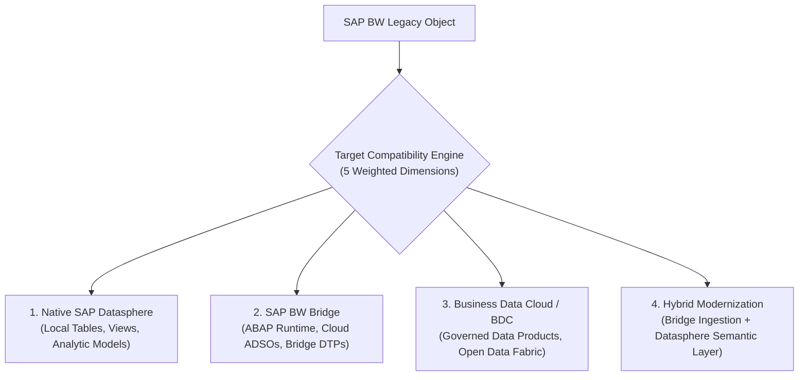

# HANAMORPH BW Migration & Modernization Studio
# M4.2 Target Modernization Architecture Compatibility Matrix

**Document Version:** 1.0.0  
**Milestone:** M4.2 (Transformation & Target Generation Intelligence)  
**Status:** APPROVED  
**Date:** 2026-11-22  

---

## 1. Architectural Scope & Target Taxonomy

Modernizing legacy SAP BW artifacts (InfoCubes, DSOs, ADSOs, InfoSets, MultiProviders, CompositeProviders, Transformations, InfoObjects, BEx Queries) requires mapping each object to its optimal cloud destination based on technical feasibility, operational cost, and organizational capability.

HANAMORPH evaluates 4 primary modernization routes across 5 weighted dimensions:
- **Functional Compatibility (35%)**: Semantic equivalence of data models, calculations, and hierarchies.
- **Technical Compatibility (25%)**: Storage engines, partitioning, data types, and indexing.
- **Process Compatibility (15%)**: Delta management, scheduling, monitoring, and orchestration.
- **Roles & Activation (15%)**: Security models, Space/Catalog permissions, and governance.
- **Platform Compatibility (10%)**: Long-term roadmaps, compute consumption, and licensing.

---

## 2. Comprehensive Target Route Evaluation Matrix

| BW Object Type | Native SAP Datasphere | SAP BW Bridge | Business Data Cloud (BDC) | Hybrid Modernization | Recommended Target Construct |
| :--- | :--- | :--- | :--- | :--- | :--- |
| **Standard ADSO** | 92% (High) | 95% (Native) | 80% (Compatible) | 90% (High) | Datasphere Local Table (CSN 2.0) |
| **Direct Update ADSO** | 78% (Partial) | 92% (Native) | 65% (Sub-optimal) | 85% (Compatible) | Datasphere Local Table with Staging API |
| **CompositeProvider** | 95% (High) | 85% (Compatible) | 92% (High) | 90% (High) | Datasphere Graphical View / Analytic Model |
| **MultiProvider** | 90% (High) | 70% (Deprecated) | 85% (Compatible) | 88% (Compatible) | Datasphere Union View |
| **InfoCube** | 88% (Compatible) | 75% (Conversion needed)| 82% (Compatible) | 85% (Compatible) | Star Schema View + Analytic Model |
| **Classic DSO** | 90% (High) | 85% (Conversion needed)| 78% (Compatible) | 88% (High) | Datasphere Ingest View + Local Table |
| **InfoObject (Master)**| 95% (High) | 92% (High) | 90% (High) | 92% (High) | Datasphere Dimension View (with Text/Attr) |
| **InfoObject (Hierarchy)**| 82% (Compatible)| 95% (Native) | 75% (Partial) | 90% (High) | Datasphere Parent-Child Hierarchy View |
| **BEx Query** | 88% (Compatible) | 70% (Runtime only)| 85% (Compatible) | 88% (Compatible) | SAP Analytics Cloud (SAC) Analytic Model |
| **Transformation (Formulas)**| 95% (High) | 95% (Native) | 88% (Compatible) | 92% (High) | Datasphere Calculated Columns / SQL View |
| **Transformation (Custom ABAP)**| 42% (Refactor) | 95% (Native) | 50% (Refactor) | 92% (Recommended)| Staged Bridge Routine or SQLScript Flow |

---

## 3. Detailed Route Profiles & Criteria

### Route 1: Native SAP Datasphere
- **Best Suited For**: Clean data marts, modern reporting, self-service business semantics, and standard data pipelines.
- **Generated Artifacts**: CSN 2.0 JSON schemas, Datasphere SQL/Graphical Views, Analytic Models, and Replication Flows.
- **Key Advantage**: Zero ABAP runtime dependency, true cloud-native elastic scaling, direct federated querying.
- **Constraints**: Custom ABAP procedural code must be refactored into declarative SQLScript or Transformation Flows.

### Route 2: SAP BW Bridge
- **Best Suited For**: Mission-critical legacy pipelines with complex ABAP logic, SAP ERP extractors (Service API / ODP), and strict delta capture requirements.
- **Generated Artifacts**: Cloud-ready ADSO definitions, InfoSource bindings, and Bridge Process Chains.
- **Key Advantage**: Reuses existing BW ABAP know-how and extractor protocols without full architectural redesign.
- **Constraints**: Higher infrastructure cost; retains procedural technical debt.

### Route 3: SAP Business Data Cloud (BDC)
- **Best Suited For**: Enterprise data mesh initiatives, cross-functional domain data products, and governed external consumption.
- **Generated Artifacts**: Data Product Contract definitions, Open Data Fabric semantic tags, SLA metadata.
- **Key Advantage**: Decouples producer models from consumer queries, enforcing semantic SLAs.
- **Constraints**: Requires curated, stable business models; unsuited for raw staging tables.

### Route 4: Hybrid Modernization
- **Best Suited For**: Complex enterprise landscapes containing both heavy legacy ERP extractors with custom routines AND demand for modern cloud analytics.
- **Generated Artifacts**: End-to-end staged architecture: BW Bridge for extraction/staging $\rightarrow$ Datasphere Space for business modeling $\rightarrow$ SAC for storytelling.
- **Key Advantage**: Highest overall risk mitigation and pragmatic evolutionary modernization.

---

## 4. Secondary & Optional Compatibility Targets

In addition to the 4 primary SAP destinations, HANAMORPH provides compatibility scoring for:
1. **SAP HANA Cloud Native**: HDI container DDL, Calculation Views, and SQLScript table functions.
2. **SAP S/4HANA Embedded Analytics**: CDS View Entities (`@Analytics.query: true`) for operational reporting.
3. **Databricks / Open Lakehouse**: PySpark ingestion scripts, Delta Lake schemas, and Unity Catalog metadata for multi-cloud lakehouse architectures.
