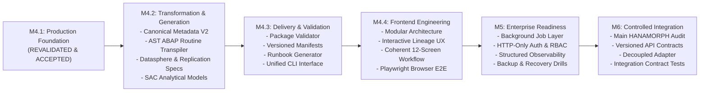

# HANAMORPH BW MIGRATION STUDIO
# MASTER EXECUTION PLAN: POST-M4.1 → M4.2 → M4.3 → M4.4 → M5 → M6

**Program Version:** 1.0.0  
**Effective Date:** 2026-11-22  
**Target Application:** Standalone BW Migration Studio (`BW_Migration_Studio/bw-studio`)  
**Repository Root:** `C:\Users\samarth\BW-hanamorph`  
**Git Branch:** `feature/bw-migration-studio` (Commit: `0c8a0fb`)  
**Scope Directive:** Complete Product Engineering Program covering M4.2 through M6. The main HANAMORPH platform (`Varad-6/HANAMORPH`) remains outside the immediate implementation boundary until Milestone M6.

---

## 1. Executive Program Overview

The objective of this engineering program is to transform the verified standalone foundation of **BW Migration Studio** into an enterprise-grade, reliable, and trustworthy SAP BW modernization software product.



---

## 2. Product Capability Inventory (Task 3)

Every major capability of the existing product has been inspected and classified against empirical reality:

| Functional Area | Current Status | Empirical Evidence / Implementation Source | Reusability Assessment |
| :--- | :---: | :--- | :--- |
| **Standalone Runtime & Server** | **WORKING_AND_VERIFIED** | `backend/server.py` (Threaded HTTP, loopback bind `127.0.0.1:4004`, graceful shutdown) | Fully reusable foundation for all subsequent milestones. |
| **API Authentication (Bearer / X-Key)** | **WORKING_AND_VERIFIED** | `backend/server.py:80-128`, `tests/test_server_live.py` (constant-time HMAC) | Fully reusable; M5 will layer HTTP-Only session cookies for browser UI. |
| **SQLite Persistence & Queue** | **WORKING_AND_VERIFIED** | `database/schema_manager.py`, `sqlite_queue.py` (WAL mode, single writer, 30 tables) | Reusable; M5 will add durable job tracking tables. |
| **SAP S21 Connectivity (Read-Only)** | **WORKING_AND_VERIFIED** | `connectors/bw_connection_manager.py`, `tests/test_live_s21_verification.py` | Strictly enforced read-only guardrails; approved benign RFCs only. |
| **5-Target Connection Hub** | **WORKING_AND_VERIFIED** | `connectors/connection_hub.py`, `credential_vault.py` (AES-256-GCM encryption) | Fully operational configuration management. |
| **Metadata Extraction & Discovery** | **WORKING_AND_VERIFIED** | `discovery/discovery_engine.py`, `parsers/adso_parser.py`, `composite_parser.py` | Extracts ADSOs, CompositeProviders, fields, and associations. |
| **Dependency Lineage & Cycles** | **WORKING_AND_VERIFIED** | `dependency_engine/dependency_graph.py` (Tarjan's SCC cycle detection) | Generates topological sorting and wave sequencing. |
| **5-Dimension Modernization Assessment**| **WORKING_AND_VERIFIED** | `assessment_engine/` (Complexity, Target Routes, Risk, Effort, Prioritization) | Operational multi-criteria decision engine. |
| **Transformation Rule Engine** | **PARTIALLY_IMPLEMENTED** | `backend/engines/transformation_engine.py` (1:1, joins, aggregations) | **Core target of M4.2:** Needs AST-based ABAP parsing and expression translation. |
| **ABAP Routine Transpilation** | **PLACEHOLDER** | Skeletal regex patterns returning placeholder comments | **Core target of M4.2:** Needs structured intermediate representation (IR). |
| **Datasphere CSN Generator** | **PARTIALLY_IMPLEMENTED** | `generation_engine/csn_generator.py` (generates basic table entities) | **Core target of M4.2:** Expand to analytical models and associations. |
| **Replication Flow Specification** | **NOT_IMPLEMENTED** | None | **Core target of M4.2:** Build dedicated Replication Flow engine. |
| **SAC Analytical Model Metadata** | **NOT_IMPLEMENTED** | None | **Core target of M4.2:** Build SAC dimensions/measures generator. |
| **7-Level Governance Validator** | **WORKING_AND_VERIFIED** | `validation_engine/validation_engine.py` (36 rules verified) | Fully operational; M4.3 will expand with package-level validation. |
| **Delivery Packaging & ZIP Export** | **WORKING_AND_VERIFIED** | `deployment/delivery_packager.py` (sealed ZIP with SHA-256 manifests) | Reusable; M4.3 will add runbook generation and versioning. |
| **12-Screen Frontend Workbench** | **WORKING_AND_VERIFIED** | `frontend/index.html` (single-page app, ~2,130 lines, dark UI) | **Core target of M4.4:** Modularize into ES6 components and add Playwright E2E. |
| **CLI Headless Operations** | **NOT_IMPLEMENTED** | Server runs via `python backend/server.py` | **Core target of M4.3:** Create `python -m bw_studio` CLI entrypoint. |
| **Durable Background Job Queue** | **NOT_IMPLEMENTED** | Synchronous HTTP calls with in-memory thread execution | **Core target of M5:** Create persistent SQLite-backed job queue. |
| **Main HANAMORPH Platform Integration**| **NOT_IMPLEMENTED** | Zero cross-studio imports (isolated repository) | **Core target of M6:** Build decoupled REST adapter and OpenAPI specs. |

---

## 3. Source-to-Roadmap Mapping (Task 4)

| Roadmap Milestone | Target Domain & Functional Scope | Modules to Reuse | Modules to Create / Extend |
| :--- | :--- | :--- | :--- |
| **Milestone M4.2** | Transformation & Target Generation Intelligence | `discovery/`, `models/`, `database/schema_manager.py` | `transformation_engine/`, `abap_transpiler/`, `generation_engine/csn_generator.py`, `replication_generator.py`, `sac_generator.py` |
| **Milestone M4.3** | Delivery, Validation & CLI Tooling | `deployment/delivery_packager.py`, `validation_engine/` | `deployment/package_validator.py`, `deployment/runbook_generator.py`, `bw_studio/cli.py` |
| **Milestone M4.4** | Frontend Modularization & Browser E2E | `frontend/index.html` (HTML structure & CSS styles) | `frontend/js/` (modular ES6: `app.js`, `api.js`, `screens/`), `tests/e2e_playwright/` |
| **Milestone M5** | Enterprise Readiness & Operational Hardening | `backend/server.py`, `database/sqlite_queue.py` | `backend/jobs/`, `backend/observability.py`, `backend/security/session_manager.py` |
| **Milestone M6** | Controlled HANAMORPH Platform Integration | None from main platform; preserve standalone studio | `docs/integration/`, `integration_adapter/`, OpenAPI specification |

---

## 4. Milestone Dependency Architecture (Task 5)

```
[M4.1: Production Foundation] (COMPLETED & VERIFIED)
           │
           ▼
[M4.2: Transformation & Generation] ──► Produces high-fidelity target artifacts & ABAP conversion
           │
           ▼
[M4.3: Delivery & Validation] ────────► Validates packages, produces runbooks & CLI entrypoints
           │
           ▼
[M4.4: Frontend Modularization] ──────► Connects hardened frontend UI to all M4.2/M4.3 engines
           │
           ▼
[M5: Enterprise Readiness] ───────────► Adds durable background jobs, HTTP-Only cookies & observability
           │
           ▼
[M6: HANAMORPH Integration] ──────────► Exposes stable REST contracts & decoupled adapter to main platform
```

### Architectural Gate Rules:
1. **M4.3 depends on M4.2:** Package validation and runbooks cannot be completed until the generation engines produce the full spectrum of artifacts (CSN, SQL, Replication, SAC).
2. **M4.4 depends on M4.2 & M4.3:** Frontend modularization must wire UI screens to finalized backend API contracts and engines.
3. **M5 depends on M4.4:** Enterprise job queuing, session management, and observability wrap the finalized application.
4. **M6 depends on M5:** Integration with the main HANAMORPH platform occurs only after the standalone BW Studio is hardened, tested, and self-sufficient.

---

## 5. Architectural Risk Register & Mitigation Strategy (Task 6)

| Risk ID | Domain | Risk Description | Severity | Concrete Mitigation Strategy |
| :---: | :--- | :--- | :---: | :--- |
| **RSK-01** | **SAP Safety** | Accidental invocation of SAP write or transport endpoints. | **CRITICAL** | Hard read-only guardrails (`BWConnectionManager`) enforce default-deny for all verbs other than `GET`/`HEAD` and block CTS paths. Zero live write operations. |
| **RSK-02** | **Transformation** | Generating syntactically incorrect or fabricated SQL for complex ABAP routines. | **HIGH** | Explicit 4-tier conversion status (`AUTOMATICALLY_CONVERTED`, `PARTIALLY_CONVERTED`, `MANUAL_REVIEW_REQUIRED`, `UNSUPPORTED`). Never fabricate code. |
| **RSK-03** | **Persistence** | Database contention or corruption under concurrent read/write operations. | **HIGH** | SQLite WAL mode with 30s busy timeout and centralized `SingleWriterQueue`. Verified online backup before every schema migration. |
| **RSK-04** | **Security** | API key theft via browser XSS due to `localStorage` token storage. | **MEDIUM** | M4.1 provides secure single-user local storage; M5 migrates frontend session to HTTP-Only, Secure, SameSite cookies. |
| **RSK-05** | **Reproducibility** | Generated delivery packages producing differing checksums across identical runs. | **MEDIUM** | Standardized artifact sorting, normalized line endings (LF), and deterministic metadata hashing. Verified in M4.3 reproducibility tests. |
| **RSK-06** | **Coupling** | Direct imports or database sharing between the main Node.js platform and BW Studio. | **HIGH** | Strict boundary: BW Studio remains 100% independent. Integration in M6 occurs exclusively over versioned HTTP/REST contracts with OpenAPI definitions. |

---

## 6. Phased Implementation Roadmap & File-Level Plan (Task 7)

### Phase 1: Milestone M4.2 — Transformation & Generation Intelligence
- **Duration / Effort:** Core Focus (Immediate)
- **Workstream 1: Canonical Metadata Model V2**
  - Extend `database/schema_manager.py` (Migration 8): add tables for `abap_routines`, `transformation_rules`, `replication_specs`, and `sac_models`.
  - Maintain stable object URNs, content fingerprints, and extraction history.
- **Workstream 2: AST-Oriented ABAP Routine Transpiler**
  - Implement `transformation_engine/abap_parser.py`: Lexer and parser for supported ABAP subset (`IF/ELSE`, `CASE/WHEN`, assignments, math, `CONCATENATE`, lookup joins).
  - Implement `transformation_engine/intermediate_representation.py`: Abstract Syntax Tree (AST) representation decoupled from target dialects.
  - Implement `transformation_engine/sql_translator.py`: Generates HANA SQLScript and Datasphere calculated column expressions.
  - Classify unsupported constructs with clear explanations, impact, and manual review actions.
- **Workstream 3: Target Architecture Engine (4 Primary Routes)**
  - Expand `assessment_engine/target_compatibility_engine.py` to evaluate:
    1. Native SAP Datasphere
    2. SAP BW Bridge
    3. SAP Business Data Cloud (BDC)
    4. Hybrid Modernization
- **Workstream 4: Expanded Generation Engine**
  - Enhance `generation_engine/csn_generator.py`: Generates full CSN definitions with analytical dimensions, measures, and associations.
  - Implement `generation_engine/replication_flow_generator.py`: Generates Replication Flow JSON specifications.
  - Implement `generation_engine/sac_model_generator.py`: Generates SAC analytical dataset metadata specifications.
  - Enforce full provenance tracking: Every artifact records source object ID, metadata fingerprint, rule IDs, and generator version.
- **Workstream 5: Testing & Verification**
  - Author unit tests for AST parser, expression translator, CSN generator, and replication flow specs.
  - Verify synthetic E2E pipeline and ensure 100% pass rate.

---

### Phase 2: Milestone M4.3 — Delivery, Validation & Migration Execution Readiness
- **Package Validation Engine:** Implement `deployment/package_validator.py` verifying package manifest, CSN schema validity, SQL syntax, and file checksums.
- **Migration Package Versioning:** Maintain versioned releases with source metadata fingerprints.
- **Migration Runbook Generator:** Implement `deployment/runbook_generator.py` generating technical Markdown and structured runbooks with cutover and rollback checklists.
- **Unified CLI Interface:** Implement `bw_studio/cli.py` exposing `python -m bw_studio` commands for inspect, assess, plan, generate, validate, and export.
- **Reproducible Exports:** Test and prove deterministic exports across identical runs.

---

### Phase 3: Milestone M4.4 — Frontend Modularization & User Workflow
- **Architecture Refactoring:** Decompose monolithic `frontend/index.html` into modular ES6 structure:
  - `frontend/css/` (styles and theme variables)
  - `frontend/js/api.js` (centralized HTTP client with auth interceptor)
  - `frontend/js/graph.js` (SVG lineage graph with pan/zoom and search)
  - `frontend/js/screens/*.js` (dedicated controllers for each of the 12 screens)
- **Lineage Visualization Enhancement:** Add zoom, pan, node expansion, upstream/downstream filtering, and wave coloring.
- **Automated Browser E2E:** Implement Playwright automated test scripts for all 12 UI screens.

---

### Phase 4: Milestone M5 — Enterprise Product Readiness
- **Background Job Layer:** Implement persistent SQLite-backed job queue for asynchronous discovery, assessment, and export.
- **HTTP-Only Session Management:** Migrate frontend authentication to HTTP-Only, Secure cookies.
- **Enterprise Observability:** Implement structured JSON logging with correlation IDs and error codes.
- **Database Scalability Assessment:** Evaluate SQLite vs PostgreSQL migration paths for high-volume enterprise deployments.
- **Operational Documentation:** Author comprehensive backup, restore, troubleshooting, and configuration guides.

---

### Phase 5: Milestone M6 — Controlled HANAMORPH Platform Integration
- **Main Platform Audit:** Audit the original 4 HANAMORPH studios (`Landing`, `CdsPipeline`, `CalcViewPipeline`, `BulkStudio`, `ReplicationStudio`) without modifying code.
- **API Contracts & OpenAPI Spec:** Publish OpenAPI 3.0 specification for all BW Studio endpoints.
- **Decoupled Integration Adapter:** Author integration adapter in Node.js/CAP allowing the host platform to trigger BW Studio operations via REST.
- **Shared Experience & Security:** Implement cross-studio navigation without leaking credentials or sharing databases.
- **Contract & Integration Tests:** Prove end-to-end multi-studio functionality while maintaining complete independence of the standalone BW Studio.

---

## 7. Immediate Next Step

With the master execution plan published and the M4.1 baseline revalidated, execution begins with **Phase 1: Milestone M4.2 (Transformation & Generation Intelligence)**.
